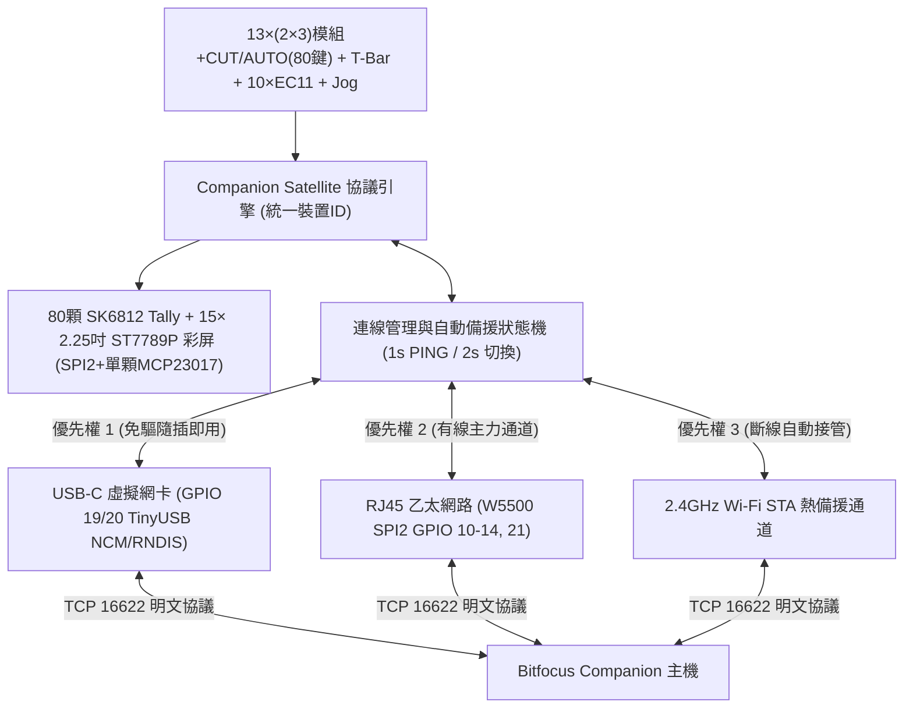
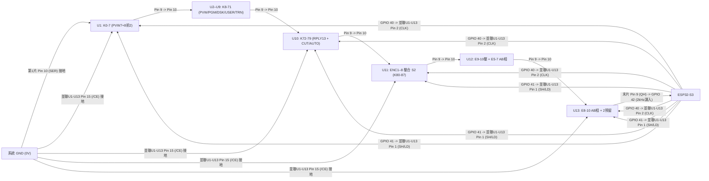
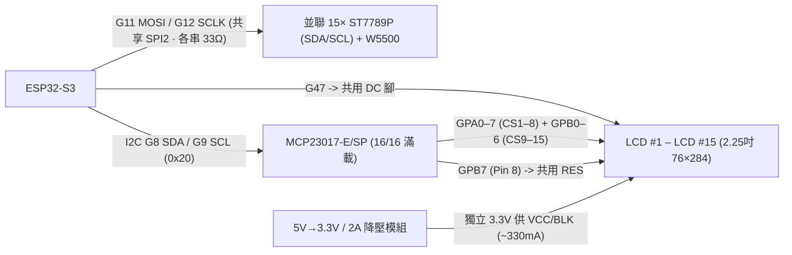
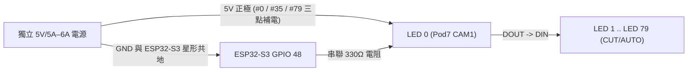
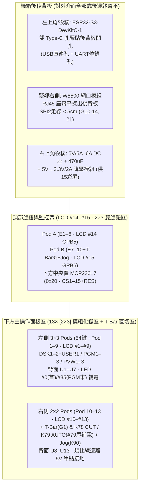
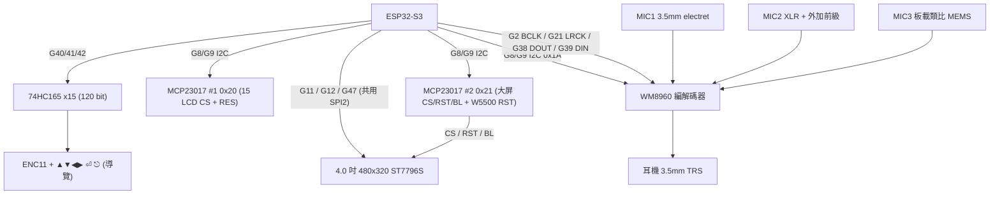

# ESP32-S3 Bitfocus Companion 80 鍵 + 10×EC11 旋鈕 + 15×2.25" 彩屏導播切換台設計規範書

本規範書涵蓋基於 **ESP32-S3-DevKitC-1 (N16R8)** 的專業級導播切換台完整架構、**Companion Satellite API** 協議定義、**「高 2 寬 3 按鍵配一螢幕 (`13× [2×3] + 2`)」80 鍵模組化矩陣 + 10× `EC11` 編碼器（雙旋鈕屏）+ 15× `2.25" (76×284 ST7789P)` 長條彩色螢幕排版規劃**、**13 片 `SN74HC165D` 級聯接線（104 路輸入 + `2 kHz` 掃描）**、**44-Pin 完整 GPIO 腳位規劃（含 `GPIO 47` LCD DC 與單顆滿載 `MCP23017 CS1–CS15 + RES`）** 與 **硬體採購清單（BOM）**。

> 搭配互動式視覺化圖表使用：
> * **A4 橫式列印版四頁工程圖紙與 BOM 手冊**：[esp32s3_printable_schematic.html](./docs/esp32s3_printable_schematic.html)
> * 滿版互動式接線計畫電路圖：[esp32s3_full_schematic_plan.html](./docs/esp32s3_full_schematic_plan.html)
> * 完整接線與 74HC165 級聯參考圖（基礎架構圖）：[esp32s3_wiring_diagram.html](./docs/esp32s3_wiring_diagram.html)
> * 80 鍵 (`13× [2×3] + 2`) + 10×EC11 + 15×2.25" 長條彩屏面板配置草圖：[switcher_panel_layout.html](./docs/switcher_panel_layout.html)
> * **全部接線單頁總電路圖（v2，含耳機/麥克風/VBAN、4.0" Config 大屏、導覽鍵）**：[esp32s3_all_wiring_big.html](./docs/esp32s3_all_wiring_big.html)
> * 🖨️ **【推薦列印】雙機完整 A4 橫式好列印版 5 頁工程圖紙（含 36 鍵 Intercom、四合一 XLR 5V/48V 音訊前端、80 鍵 v2 升級與雙機 BOM）**：[esp32s3_v2_and_intercom_printable.html](./docs/esp32s3_v2_and_intercom_printable.html)
> * 🌐 **【互動體驗】雙機完整視覺化規格、36 鍵面板模擬器 & 內建 Web UI 設定後台原型（含固定 IP / VBAN 改名上屏預覽）**：[vban_system_overview_and_webui.html](./docs/vban_system_overview_and_webui.html)
> * 🎧 **獨立姊妹機：ESP32-S3 VBAN 路由拆分器 & 36 鍵 (`6× [2×3]`) 多工位 Intercom 主站**：
>   * 完整設計規範書：[vban_intercom_station.md](./docs/vban_intercom_station.md)
>   * 單頁全接線總電路圖（雙 SPI 分流架構）：[vban_intercom_wiring_big.html](./docs/vban_intercom_wiring_big.html)
>
> **📌 v2 擴充說明**：第六章新增 **耳機功放 + 麥克風 + VBAN 收發**、**4.0" Config 大螢幕 + LVGL 虛擬鍵盤**、**ENC11 + ▲▼◀▶ ⏎ ⎋ 導覽鍵**。第一至五章保留 v1 基礎設計；**凡與第六章衝突之處（`GPIO 2/21/38/39`、`E4`、`W5500 RST`、74HC165 片數 13→15、擴展接口數）以第六章為準**，下列表格已同步更新。

---

## 一、專案架構總覽（三模自動備援 + Satellite API）

### 1.1 系統通訊與連接架構
電腦端只需安裝並執行 **Bitfocus Companion 主程式**（無需額外下載安裝獨立的 `companion-satellite` 轉發軟體），主程式啟動後會在背景自動開放 **TCP `16622` 連接埠**（並透過 mDNS 廣播 `_companion-satellite._tcp.local`）。

ESP32-S3 透過統一的上層協議棧與固定 `DEVICEID`（建議綁定晶片出廠 MAC，如 `esp32s3`），在三種實體通道之間無縫切換或熱備援：



### 1.2 三模分級特性與備援策略
1. **優先權 1：USB-C 直連（TinyUSB RNDIS / CDC-NCM 虛擬網卡）**
   * ESP32-S3 透過原生 USB 孔（`GPIO 19/20`）模擬為 USB 網卡，電腦端自動分配區網 IP（如 `192.168.7.1`），ESP32 直接向 `192.168.7.1:16622` 建立 TCP 連線，100% 共用同一套網路協議程式碼。
   * 支援有線全功能模式：高更新率 T-Bar 取樣（100Hz）、動態按鍵名稱（分時輪詢更新 15 塊 `2.25" ST7789P` 彩屏）與全亮度 Tally 燈光。
2. **優先權 2：RJ45 有線網口（W5500 SPI2）**
   * 預設高優先權網路路由，透過 `GPIO 14`（W5500 `INT` 硬體中斷）實現毫秒級拔線感知；與 15 顆彩屏共享 `SPI2 (G11 MOSI / G12 SCLK)`，透過獨立 CS（W5500 `G10` vs LCD `MCP GPA0–7 / GPB0–6`）分時複用不衝突。
3. **優先權 3：Wi-Fi 無線備援（熱待命）**
   * 與 W5500 同時保持待機或熱備援。若實體網路線被拔除（`ETH_EVENT_DISCONNECTED`）或 Satellite 心跳 `PING` 連續 2 秒未收到 `PONG`，狀態機自動切換至 Wi-Fi 通道重連；因 `DEVICEID` 固定不變，Companion 會立即自動下發當前頁面所有紅/綠 Tally 燈色與文字標籤而不遺失按鍵設定。
   * 無線降級保護：在 Wi-Fi 模式下自動將 T-Bar 上報降頻至 25Hz 並關閉點陣圖示流（`BITMAPS=0`，僅下發純文字 `TEXT=true` 更新彩屏），確保切台指令零阻塞。

### 1.3 Satellite API 核心指令規範（每行以 `\n` 結尾）
```text
# 1. 連線握手（Companion -> ESP32）
BEGIN CompanionVersion="3.4.0" ApiVersion="1.8.0"

# 2. 註冊 80 鍵原生面板（ESP32 -> Companion；含 KEY 0–79 實體鍵，另保留 KEY 80–90 給 10×EC11 與 Jog）
ADD-DEVICE DEVICEID=esp32s3 PRODUCT_NAME="ESP32-S3 80-Key + 10-Enc 15-LCD Switcher" KEYS_TOTAL=80 KEYS_PER_ROW=10 BITMAPS=0 COLORS=rgb TEXT=true

# 3. 實體按鍵觸發（ESP32 -> Companion，KEY 0–79）
KEY-PRESS DEVICEID=esp32s3 KEY=18 PRESSED=true

# 4. 旋鈕 (KEY 80–89) / 時間軸滾盤 Jog (KEY 90) 觸發（ESP32 -> Companion）
KEY-ROTATE DEVICEID=esp32s3 KEY=90 DIRECTION=1

# 5. T-Bar 連續推桿變數上報（ESP32 -> Companion，VALUE 為 Base64 編碼）
SET-VARIABLE-VALUE DEVICEID=esp32s3 VARIABLE=tbar VALUE=MTAw

# 6. Companion 主動下發逐鍵 RGB Tally 顏色與標籤文字（同步更新 LED 燈與對應 Pod LCD 螢幕）
KEY-STATE DEVICEID=esp32s3 KEY=18 COLOR=rgb(255,0,0) TEXT="Q0FNIDE="
```

---

## 二、80 鍵 (`13× [2×3] + 2`) + 10×EC11 + 15× 2.25" 長條彩屏排版與映射表

整機升級為 **「高 2 寬 3 按鍵模組＋專屬一顆 `2.25"` 彩屏」** 的統一模組化架構：
* **主鍵盤與功能區**：將 78 顆按鍵拆分為 **13 組 `2高×3寬 (2×3)` 獨立模組 (`Pod 1–13`)**，每組正上方均配備 1 顆專屬 **`2.25" (76×284 ST7789P)` 彩屏 (`LCD #1–#13`)**，螢幕水平顯示面積 (`53.28mm`) 與外觀寬度 (`63.2mm`) 剛好覆蓋 3 顆 1U 按鍵 (`~57.15mm`)，讓上排 3 格與下排 3 格精準垂直對齊、視覺零跨界！外加 **2 顆直切大鍵 (`KEY 78 CUT` / `KEY 79 AUTO`)** 置於右側 `T-Bar` 下方，總計仍為 **80 顆機械按鍵 (`KEY 0–79`)**，完整填滿 `U1–U10` 10 片 `74HC165`。
* **頂部旋鈕與狀態雙模組**：頂部 **`10× EC11` (`KEY 80–89`) + `T-Bar` + `Jog` (`KEY 90`)** 同步採用 2 組 `2×3` 模組化配置，對應 **`LCD #14` (`GPB5`)** 與 **`LCD #15` (`GPB6`)**。
* **單顆 `MCP23017` 滿載剛剛好**：15 顆彩屏的 `CS1–CS15` 與共用 `RES` 剛好佔滿單片 **`MCP23017-E/SP (0x20)` 的 16/16 支 IO**（`GPA0–7` = `CS1–8`，`GPB0–6` = `CS9–15`，`GPB7` = 共用 `RES`），**主控 ESP32-S3 GPIO 佔用零增加**！

```text
┌──────────────────────────────────────────────────────────┬────────────────────────────────────────┐
│ [ LCD #14 · GPB5 · 旋鈕模組 A (2×3 · K80–85) ]          │ [ LCD #15 · GPB6 · 旋鈕/動態模組 B (2×3) ]│
│  ⚪E1主音量   ⚪E2主持麥1  ⚪E3來賓麥2                  │  ⚪E7 PIP-Y   ⚪E8 PIP縮放   🎚️ T-Bar % │
│  ⚪E4 VTR音   ⚪E5監聽耳機 ⚪E6 PIP-X                    │  ⚪E9 DSK透明 ⚪E10轉場秒    🎛️ Jog(K90)│
├──────────────────┬──────────────────┬──────────────────┼────────────────────────────────────────┤
│ [LCD #1 · GPA0]  │ [LCD #2 · GPA1]  │ [LCD #3 · GPA2]  │ [LCD #10 · GPB1]   │ [LCD #11 · GPB2]   │
│ Pod1 DSK1 (K36–41│ Pod2 DSK2(K42–47)│ Pod3 USER1(48–53)│ Pod10 USER2(K54–59)│ Pod11 TRANS1(60–65)│
│ DSK1  DSK2  PIP1 │ STL1  STL2  KEY1 │ F1宏1 F2宏2 F3音1│ F7拍  F8靜  F9備1  │ MIX   WIPE  DIP    │
│ PIP2  LOGO  TITL │ KEY2  REC   LIVE │ F4音2 F5字  F6計時│ F10備2 AUX3 MUTE   │ STING DVE   PREV   │
├──────────────────┼──────────────────┼──────────────────┼────────────────────┼──────────────────┤
│ [LCD #4 · GPA3]  │ [LCD #5 · GPA4]  │ [LCD #6 · GPA5]  │ [LCD #12 · GPB3]   │ [LCD #13 · GPB4]   │
│ Pod4 PGM1 (K18–23│ Pod5 PGM2(K24–29)│ Pod6 PGM3(K30–35)│ Pod12 TRANS2(66–71)│ Pod13 REPLAY(72–77)│
│ CAM1  CAM2  CAM3 │ CAM7  CAM8  PC1  │ VTR1  VTR2  PPT  │ BKGD  KEY3  DSK3   │ IN    OUT   MARK   │
│ CAM4  CAM5  CAM6 │ PC2   MV1   MV2  │ GFX1  AUX1  AUX2②│ FTB   LOCK  NORM   │ RPLY  PG-   PG+    │
├──────────────────┼──────────────────┼──────────────────┼────────────────────┴──────────────────┤
│ [LCD #7 · GPA6]  │ [LCD #8 · GPA7]  │ [LCD #9 · GPB0]  │ ┌────────────┬─────────┬────────────┐  │
│ Pod7 PVW1 (K0–5) │ Pod8 PVW2 (K6–11)│ Pod9 PVW3(K12–17)│ │ 🎚️ T-Bar   │K78  CUT │ 🎛️ Jog     │  │
│ CAM1① CAM2  CAM3 │ CAM7  CAM8  PC1  │ VTR1  VTR2  PPT  │ │ (B10K · G1)│K79 AUTO③│ (K90 G4/G5)│  │
│ CAM4  CAM5  CAM6 │ PC2   MV1   MV2  │ GFX1  AUX1  AUX2 │ └────────────┴─────────┴────────────┘  │
└──────────────────┴──────────────────┴──────────────────┴────────────────────────────────────────┘
 * ① LED #0 (Pod7 CAM1) 首端補電 / ② LED #35 (Pod6 AUX2) 中段補電 / ③ LED #79 (T-Bar AUTO) 尾端補電
```

### 2.1 13× (`2×3`) 模組 + 直切大鍵 + 10×EC11 / Jog 完整 KEY 映射表
| 模組位置 | 實體矩陣佈局 | Companion 映射編號 | 按鍵 / 功能定義（上排 3 鍵 / 下排 3 鍵） | Tally 顏色 / 專屬彩屏 |
| :--- | :--- | :--- | :--- | :--- |
| **左側第 1 層 `Pod 1` (DSK 1)** | `2×3`（6 鍵） | `KEY 36` – `KEY 41` | 上：`DSK1, DSK2, PIP1` / 下：`PIP2, LOGO, TITLE` | 琥珀·藍 / **LCD #1 (`GPA0`)** |
| **左側第 1 層 `Pod 2` (DSK 2)** | `2×3`（6 鍵） | `KEY 42` – `KEY 47` | 上：`STILL1, STILL2, KEY1` / 下：`KEY2, REC, LIVE` | 紅·白 / **LCD #2 (`GPA1`)** |
| **左側第 1 層 `Pod 3` (USER 1)** | `2×3`（6 鍵） | `KEY 48` – `KEY 53` | 上：`F1宏1, F2宏2, F3音1` / 下：`F4音2, F5字幕, F6計時` | 紫色 / **LCD #3 (`GPA2`)** |
| **左側第 2 層 `Pod 4` (PGM 1)** | `2×3`（6 鍵） | `KEY 18` – `KEY 23` | 上：`CAM1, CAM2, CAM3` / 下：`CAM4, CAM5, CAM6` | 紅燈 / **LCD #4 (`GPA3`)** |
| **左側第 2 層 `Pod 5` (PGM 2)** | `2×3`（6 鍵） | `KEY 24` – `KEY 29` | 上：`CAM7, CAM8, PC1` / 下：`PC2, MV1, MV2` | 紅燈 / **LCD #5 (`GPA4`)** |
| **左側第 2 層 `Pod 6` (PGM 3)** | `2×3`（6 鍵） | `KEY 30` – `KEY 35` | 上：`VTR1, VTR2, PPT` / 下：`GFX1, AUX1, AUX2`（`#35` 中段補電） | 紅燈 / **LCD #6 (`GPA5`)** |
| **左側第 3 層 `Pod 7` (PVW 1)** | `2×3`（6 鍵） | `KEY 0` – `KEY 5` | 上：`CAM1`（`#0` 首補電）`, CAM2, CAM3` / 下：`CAM4, CAM5, CAM6` | 綠燈 / **LCD #7 (`GPA6`)** |
| **左側第 3 層 `Pod 8` (PVW 2)** | `2×3`（6 鍵） | `KEY 6` – `KEY 11` | 上：`CAM7, CAM8, PC1` / 下：`PC2, MV1, MV2` | 綠燈 / **LCD #8 (`GPA7`)** |
| **左側第 3 層 `Pod 9` (PVW 3)** | `2×3`（6 鍵） | `KEY 12` – `KEY 17` | 上：`VTR1, VTR2, PPT` / 下：`GFX1, AUX1, AUX2` | 綠燈 / **LCD #9 (`GPB0`)** |
| **右側第 1 層 `Pod 10` (USER 2)** | `2×3`（6 鍵） | `KEY 54` – `KEY 59` | 上：`F7抓拍, F8靜音, F9備1` / 下：`F10備2, AUX3, MUTE` | 紫色 / **LCD #10 (`GPB1`)** |
| **右側第 1 層 `Pod 11` (TRANS 1)** | `2×3`（6 鍵） | `KEY 60` – `KEY 65` | 上：`MIX, WIPE, DIP` / 下：`STING, DVE, PREV` | 藍·綠 / **LCD #11 (`GPB2`)** |
| **右側第 2 層 `Pod 12` (TRANS 2)** | `2×3`（6 鍵） | `KEY 66` – `KEY 71` | 上：`BKGD, KEY3, DSK3` / 下：`FTB, LOCK, NORM` | 紅·琥珀 / **LCD #12 (`GPB3`)** |
| **右側第 2 層 `Pod 13` (REPLAY)** | `2×3`（6 鍵） | `KEY 72` – `KEY 77` | 上：`IN, OUT, MARK` / 下：`RPLY, PG-, PG+` | 青·白 / **LCD #13 (`GPB4`)** |
| **右側底部：T-Bar 直切雙鍵** | `2×1` 獨立大鍵 | `KEY 78`, `KEY 79` | `K78 = CUT`（硬切） / `K79 = AUTO`（自動轉場，`#79` 尾端補電） | 紅·綠 / 緊鄰 T-Bar (`U10.G/H`) |
| **頂部：`Pod A` (EC11 1–6)** | `2×3` 旋鈕帶按壓 | `KEY 80` – `KEY 85` | `E1 主音量, E2 麥1, E3 麥2` / `E4 VTR音, E5 監聽, E6 PIP-X` | **LCD #14 (`GPB5`)** 6 格數值 |
| **頂部：`Pod B` (EC11 7–10+雙類比)** | `2×3` 複合模組 | `K86–89`, `K90`, `tbar` | 上：`E7 PIP-Y, E8 縮放, T-Bar %` / 下：`E9 DSK透, E10 轉秒, Jog TC` | **LCD #15 (`GPB6`)** 6 格狀態 |

### 2.2 15× `2.25" (76×284 ST7789P)` 彩色長條屏完整分配表（ZJY225S0800TG01）
單塊模組尺寸 `63.2 × 21.2 mm`（橫放解析度 `284 × 76 px`）。每組 **`2×3` 鍵寬度 (`3U ≈ 57.15mm`)** 與螢幕視口完美貼合，並將 **單顆 `MCP23017-E/SP (0x20)` 的 16 個接腳 100% 用盡**（`GPA0–7` + `GPB0–6` 分別為 `CS1–CS15`，`GPB7` 為全部 15 塊螢幕共用 `RES`）：

| 螢幕編號 | `MCP23017` 腳位 | 對應模組與 KEY 範圍 | 畫面格線分割（`2×3` 鍵完美對齊 6 格標籤） |
| :--- | :--- | :--- | :--- |
| **`LCD #1`** | `GPA0 (Pin 21)` -> `CS1` | **Pod 1 · DSK 1** (`KEY 36–41`) | 上排 3 格 `DSK1/DSK2/PIP1` · 下排 3 格 `PIP2/LOGO/TITLE` |
| **`LCD #2`** | `GPA1 (Pin 22)` -> `CS2` | **Pod 2 · DSK 2** (`KEY 42–47`) | 上排 3 格 `STILL1/STILL2/KEY1` · 下排 3 格 `KEY2/REC/LIVE` |
| **`LCD #3`** | `GPA2 (Pin 23)` -> `CS3` | **Pod 3 · USER 1** (`KEY 48–53`) | 上排 3 格 `F1宏1/F2宏2/F3音1` · 下排 3 格 `F4音2/F5字/F6計時` |
| **`LCD #4`** | `GPA3 (Pin 24)` -> `CS4` | **Pod 4 · PGM 1** (`KEY 18–23`) | 上排 `CAM1–3` · 下排 `CAM4–6` + PGM 紅條 Tally 狀態 |
| **`LCD #5`** | `GPA4 (Pin 25)` -> `CS5` | **Pod 5 · PGM 2** (`KEY 24–29`) | 上排 `CAM7/CAM8/PC1` · 下排 `PC2/MV1/MV2` |
| **`LCD #6`** | `GPA5 (Pin 26)` -> `CS6` | **Pod 6 · PGM 3** (`KEY 30–35`) | 上排 `VTR1/VTR2/PPT` · 下排 `GFX1/AUX1/AUX2` |
| **`LCD #7`** | `GPA6 (Pin 27)` -> `CS7` | **Pod 7 · PVW 1** (`KEY 0–5`) | 上排 `CAM1–3` · 下排 `CAM4–6` + PVW 綠條 Tally 狀態 |
| **`LCD #8`** | `GPA7 (Pin 28)` -> `CS8` | **Pod 8 · PVW 2** (`KEY 6–11`) | 上排 `CAM7/CAM8/PC1` · 下排 `PC2/MV1/MV2` |
| **`LCD #9`** | `GPB0 (Pin 1)` -> `CS9` | **Pod 9 · PVW 3** (`KEY 12–17`) | 上排 `VTR1/VTR2/PPT` · 下排 `GFX1/AUX1/AUX2` |
| **`LCD #10`** | `GPB1 (Pin 2)` -> `CS10` | **Pod 10 · USER 2** (`KEY 54–59`) | 上排 `F7拍/F8靜/F9備1` · 下排 `F10備2/AUX3/MUTE` |
| **`LCD #11`** | `GPB2 (Pin 3)` -> `CS11` | **Pod 11 · TRANS 1** (`KEY 60–65`) | 上排 `MIX/WIPE/DIP` · 下排 `STING/DVE/PREV` |
| **`LCD #12`** | `GPB3 (Pin 4)` -> `CS12` | **Pod 12 · TRANS 2** (`KEY 66–71`) | 上排 `BKGD/KEY3/DSK3` · 下排 `FTB/LOCK/NORM` |
| **`LCD #13`** | `GPB4 (Pin 5)` -> `CS13` | **Pod 13 · REPLAY** (`KEY 72–77`) | 上排 `IN/OUT/MARK` · 下排 `RPLY/PG-/PG+`（含當前 Page 提示） |
| **`LCD #14`** | `GPB5 (Pin 6)` -> `CS14` | **Pod A · EC11 1–6** (`KEY 80–85`) | 上排 `E1主音/E2麥1/E3麥2` · 下排 `E4 VTR/E5監聽/E6 X` |
| **`LCD #15`** | `GPB6 (Pin 7)` -> `CS15` | **Pod B · EC11 7–10 + 推桿/滾盤** | 上排 `E7 Y/E8縮放/T-Bar %` · 下排 `E9透明/E10轉秒/Jog TC碼` |
| *共用腳位* | `GPB7 (Pin 8)` -> `RES` | **全部 15 塊彩屏共用硬體復位** | 低電平脈衝同時復位 LCD #1–#15（`16/16 腳位滿載`，無需擴充第二顆 MCP） |

---

## 三、ESP32-S3-DevKitC-1 (N16R8) 全腳位分配總表（v2：已用 29 · 空腳 0 · 禁區 7）

升級為 **80 鍵 + 10×EC11 + 15×彩屏** 後，主控 ESP32-S3 GPIO **依然維持零增加**（v1 為 `28 已用 + 1 空腳 + 7 禁區`；**v2 為 `29 已用 + 0 空腳 + 7 禁區`**，`GPIO 2` 已作 I2S BCLK）。以 USB 連接埠朝下、Wi-Fi 天線朝上為基準，核對 **J1（左側 22 腳）** 與 **J3（右側 22 腳）**：

### 3.1 J1 排針（左側腳位 1–22）
| 實體腳號 | 腳位絲印 | 分配模組 | 外設目標腳 | 功能與硬體說明 |
| :--- | :--- | :--- | :--- | :--- |
| `J1-1` | `3V3` | 系統電源 | 邏輯供電正極 | 供 `U1–U13 74HC165`、`W5500`、`MCP23017`、`T-Bar` 使用 |
| `J1-2` | `3V3` | 獨立降壓說明 | （不直接從開發板拉彩屏大電流） | **15 顆 `2.25"` 彩屏 (~330mA) 由外部 `5V→3.3V/2A` 降壓模組供電，僅共地 GND** |
| `J1-3` | `RST` | 系統控制 | `EN` 復位 | 板載復位開關 |
| `J1-4` | `GPIO 4` | **Jog 滾盤** | 手輪 `A` 相 | **硬體 PCNT0**（高速旋轉不掉步，4.7kΩ 上拉至 `3.3V`） |
| `J1-5` | `GPIO 5` | **Jog 滾盤** | 手輪 `B` 相 (`KEY 90`) | **硬體 PCNT0**（4.7kΩ 上拉至 `3.3V`） |
| `J1-6` | `GPIO 6` | **EC11 旋鈕 1** | 旋鈕 1 `A` 相 (`KEY 80`) | **硬體 PCNT1**（主音量；按壓 `S2` 接 `U11.A`） |
| `J1-7` | `GPIO 7` | **EC11 旋鈕 1** | 旋鈕 1 `B` 相 | **硬體 PCNT1** |
| `J1-8` | `GPIO 15` | **EC11 旋鈕 2** | 旋鈕 2 `A` 相 (`KEY 81`) | **硬體 PCNT2**（主持麥 1；按壓 `S2` 接 `U11.B`） |
| `J1-9` | `GPIO 16` | **EC11 旋鈕 2** | 旋鈕 2 `B` 相 | **硬體 PCNT2** |
| `J1-10` | `GPIO 17` | **EC11 旋鈕 3** | 旋鈕 3 `A` 相 (`KEY 82`) | **硬體 PCNT3**（來賓麥 2；按壓 `S2` 接 `U11.C`） |
| `J1-11` | `GPIO 18` | **EC11 旋鈕 3** | 旋鈕 3 `B` 相 | **硬體 PCNT3** |
| `J1-12` | `GPIO 8` | **I2C 總線** | `SDA` 資料線 | **必選 `MCP23017 (0x20)` 滿載擴充 `CS1–CS15 + RES` + 備用 `OLED`** |
| `J1-13` | `GPIO 3` | ⚠️ 保留禁用 | — | Strapping 啟動設定腳（勿接外設） |
| `J1-14` | `GPIO 46` | ⚠️ 保留禁用 | — | Strapping ROM 日誌腳（勿接外設） |
| `J1-15` | `GPIO 9` | **I2C 總線** | `SCL` 時脈線 | **`MCP23017` + 備用 OLED 共享總線**（4.7kΩ 上拉至 3.3V） |
| `J1-16` | `GPIO 10` | **W5500 網口** | `SCS / CS` | 原生 FSPI (`SPI2`) W5500 專屬片選（15 屏片選改由 `MCP GPA0–7/GPB0–6` 控制） |
| `J1-17` | `GPIO 11` | **SPI2 共享輸出** | `MOSI` (`W5500 + 15×LCD SDA`) | **並聯 `W5500` 與 `15× 2.25" ST7789P SDA`**（建議每分支串 `33Ω` 阻尼電阻） |
| `J1-18` | `GPIO 12` | **SPI2 共享時脈** | `SCLK` (`W5500 + 15×LCD SCL`) | **並聯 `W5500` 與 `15× 2.25" ST7789P SCL`**（建議串 `33Ω` 阻尼，時脈設 20–26MHz 更穩） |
| `J1-19` | `GPIO 13` | **W5500 網口** | `MISO` | 原生 FSPI (`FSPIQ`，僅接 W5500，ST7789P 無 MISO) |
| `J1-20` | `GPIO 14` | **W5500 網口** | `INT` 中斷 | 網口中斷（低電平有效，觸發快速備援） |
| `J1-21` | `5V` | 系統電源 | 5V 總線 | 接外部 `5V/5A–6A` 供電與 `5V→3.3V/2A` 彩屏降壓模組 |
| `J1-22` | `GND` | 系統地 | `GND` | 全部模組星形單點共地 |

### 3.2 J3 排針（右側腳位 1–22）
| 實體腳號 | 腳位絲印 | 分配模組 | 外設目標腳 | 功能與硬體說明 |
| :--- | :--- | :--- | :--- | :--- |
| `J3-1` | `GND` | 系統地 | `GND` | 全部模組共地 |
| `J3-2` | `GPIO 43` | 除錯串口 | `UART0 TX` | 板載 UART Type-C 孔燒錄與日誌輸出 |
| `J3-3` | `GPIO 44` | 除錯串口 | `UART0 RX` | 板載 UART Type-C 孔接收 |
| `J3-4` | `GPIO 1` | **T-Bar 推桿** | 電位器滑臂 `Wiper` | **必須用 `ADC1_CH0`（開啟 Wi-Fi 不衝突）** |
| `J3-5` | `GPIO 2` | **I2S 音訊（v2）** | `WM8960 BCLK` | 位元時脈輸出（原唯一空腳，v2 起用於音訊，見第六章） |
| `J3-6` | `GPIO 42` | **74HC165 掃描鏈** | 末片 `U13 QH/Q7` (Pin 9) | 串列資料讀入（`2 kHz` 定時器掃描 `13×8 = 104 bits`） |
| `J3-7` | `GPIO 41` | **74HC165 掃描鏈** | 全部 `U1–U13 SH/LD` (Pin 1) | 並行鎖存脈衝（低電平同時鎖存 80 鍵與 E5–10 狀態） |
| `J3-8` | `GPIO 40` | **74HC165 掃描鏈** | 全部 `U1–U13 CLK` (Pin 2) | 移位時脈脈衝（GPIO 直連 Bit-bang 或 SPI 高速讀取） |
| `J3-9` | `GPIO 39` | **I2S 音訊（v2）** | `WM8960 ADCDAT` → `DIN` | 麥克風資料輸入（原 E4 B 相，E4 已搬到 `U15.A`） |
| `J3-10` | `GPIO 38` | **I2S 音訊（v2）** | `WM8960 DACDAT` ← `DOUT` | 耳機資料輸出（原 E4 A 相，E4 已搬到 `U14.H`） |
| `J3-11` | `GPIO 37` | ⛔ **嚴禁外接** | — | **N16R8 內部 Octal PSRAM 佔用** |
| `J3-12` | `GPIO 36` | ⛔ **嚴禁外接** | — | **N16R8 內部 Octal PSRAM 佔用** |
| `J3-13` | `GPIO 35` | ⛔ **嚴禁外接** | — | **N16R8 內部 Octal PSRAM 佔用** |
| `J3-14` | `GPIO 0` | ⚠️ 保留禁用 | — | Strapping BOOT 按鍵腳 |
| `J3-15` | `GPIO 45` | ⛔ **嚴禁外接** | — | Strapping `VDD_SPI` 電壓選擇腳 |
| `J3-16` | `GPIO 48` | **SK6812 燈鏈** | 第 1 顆 `DIN` | **硬體 RMT 輸出**（串聯 `330Ω` 電阻後接 `LED #0..#79`） |
| `J3-17` | `GPIO 47` | **15× 2.25" 彩屏** | 並聯 `DC` 資料/命令腳 | **15 塊 `ST7789P` 共用 `DC` 腳** |
| `J3-18` | `GPIO 21` | **I2S 音訊（v2）** | `WM8960 LRCK (WS)` | 左右聲道時脈（W5500 `RST` 已改由 `MCP23017 #2 GPA2` 控制） |
| `J3-19` | `GPIO 20` | **USB-C 直連** | `USB D+` | 板載 USB Type-C 孔直連，勿外接其它元件 |
| `J3-20` | `GPIO 19` | **USB-C 直連** | `USB D-` | 板載 USB Type-C 孔直連，勿外接其它元件 |
| `J3-21` | `GND` | 系統地 | `GND` | 全部模組共地 |
| `J3-22` | `GND` | 系統地 | `GND` | 全部模組共地 |

---

## 四、分模組電路接線圖與硬體注意事項

### 4.1 按鍵掃描鏈：`13× SN74HC165D` 前後級串聯接線（80 鍵 + 10 旋鈕按壓 + `E5–E10` A/B + 2 預留）
> 所有晶片共用 `GPIO 40 (CLK)`、`GPIO 41 (SH/LD)`，且 **全部 Pin 15 (`/CE`) 必須接地**。前後級採用 **菊花鏈（Daisy Chain）** 從 `U1` 一級串到 `U13`（共 `104 bits`），ESP32 永遠只佔用 **3 支 GPIO**！配合韌體 **`2 kHz` (`500 μs`) 硬體定時器中斷掃描**與灰碼（Gray-code）狀態機解碼，`E5–E10` 旋鈕即使快轉也不會掉步。



* **單顆按鍵 / EC11 與排阻接法**：每個機械軸或 EC11 `A/B/S2` 接腳一端接 `GND`，另一端同時接 `74HC165` 輸入腳（`Pin 11–14, Pin 3–6`）以及一顆 **`10kΩ` 上拉電阻到 `3.3V`**（強烈建議買 **9 腳 `10kΩ` 排阻 `A103J`**，13 片晶片各配 1 條排阻，焊接最省時）。
* **電源退耦**：每片 `74HC165` 的 `VCC`（Pin 16 接 `3.3V`）與 `GND`（Pin 8）之間就近並聯一顆 **`100nF (0.1μF)` 退耦電容**。

### 4.2 `15× 2.25" (76×284 ST7789P)` 彩屏 + 單顆滿載 `MCP23017` CS 擴充接線
為確保 **13 組 `2×3` 按鍵模組與頂部 2 組旋鈕區** 都能各自擁有專屬動態畫面，採用 **「SPI2 共用匯流排 + `GPIO 47` 共用 DC + 單片 `MCP23017` 滿載出 `CS1–CS15` 與共用 `RES`」** 的零額外 MCU GPIO 方案：



* **模組接腳接法**：建議採購淘寶中景園 **「焊接式對應模組（排針默認不焊接）」**，背面 8 個焊盤（`GND / VCC / SCL / SDA / RES / DC / CS / BLK`）可直接焊 8-Pin 排針或軟排線轉接；15 顆螢幕的 `VCC` 與 `BLK` 全數接至獨立 `3.3V/2A` 降壓模組輸出端，並建議每隔 2–3 塊屏在 `VCC–GND` 並聯一顆 `100nF` 電容穩定背光電源。
* **`MCP23017` 外圍必須條件**：`VDD` 接 `3.3V`（並 `100nF` 到 GND），`VSS` 接 `GND`，`A0/A1/A2` 接地（位址 `0x20`），`RESET (Pin 18)` 須接 `10kΩ` 上拉至 `3.3V`（不可懸空），`SDA/SCL` 對 `3.3V` 各接 **`4.7kΩ` 上拉電阻**。
* **15 顆並聯高速訊號完整度保護**：單條 `SPI2` 同時並接 `W5500` 與 `15 顆 ST7789P` 時，電容負載較高，**務必在 `G11 MOSI` 與 `G12 SCLK` 主幹分支端串聯 `33Ω` 阻尼電阻**、盡量縮短面板背面排線（總長 `< 25cm`），並將 `ST7789P` 的 SPI 時脈設定在 `20MHz–26MHz`（15 顆螢幕文字/狀態局部刷新極快，無需強推 40MHz 即可穩定無殘影）。

### 4.3 全彩 Tally 燈鏈：`80× SK6812 MINI-E` 供電與信號接線


* **功耗預算**：單顆 `SK6812` 全白最亮約 `45–60mA`，80 顆全亮理論峰值約 `3.6A–4.8A`，再加 15 顆 `2.25"` 彩屏約 `330mA`（經 `5V→3.3V` 降壓後約 `240mA@5V`），**必須使用獨立 `5V / 5A–6A` 供電軌**，並與 ESP32-S3 **星形共地 (`GND`)**。
* **三點補電點位**：必須使用 `20AWG` 粗線在 **`LED #0`（PVW Pod 7 CAM1 起點）、`LED #35`（PGM Pod 6 末顆 AUX2）、`LED #79`（T-Bar AUTO 尾顆）** 同時補入 `5V` 與 `GND`。
* **信號與電容配置**：`GPIO 48` 串 **`330Ω`** 後進 `LED #0 DIN`；燈鏈首端並 **`470μF / 10V`** 電解電容吸收浪湧，長線閃爍可加 `SN74AHCT125`。

### 4.4 T-Bar 推桿與時間軸滾盤（Jog Wheel）電路保護
* **T-Bar（`ALPS RS6011` / `Bourns PTA6043` B10K 線性推桿）**：
  * 1 腳接 `GND`，3 腳接 `3.3V`，2 腳（中心滑臂）接 **`GPIO 1 (ADC1_CH0)`**。
  * 在 `GPIO 1` 與 `GND` 之間並聯 **`100nF` 瓷片電容** 抑制滑動接觸雜訊。
* **時間軸滾盤（5V CNC 電子手輪 MPG 100PPR / `LPD3806-100BM`）**：
  * 供電端接 `5V` 與 `GND`。
  * 若為 **NPN 集電極開路（Open-Collector）** 版本，將 `A`、`B` 相透過 **`4.7kΩ` 電阻上拉至 `3.3V`**（**嚴禁上拉到 5V！**）再接入 `GPIO 4` 和 `GPIO 5`（`KEY 90`）；若為推挽 5V 輸出版本，需經電阻分壓（如 `2.2kΩ` + `3.3kΩ`）或電平轉換模組降壓至 3.3V。

### 4.5 各外設模組自身針腳排列（Pinout）與逐針接線明細

#### 1. `W5500` 乙太網路模組針腳對照（涵蓋市面最常見的兩種封裝板）
| 常見標準 **10-Pin (2×5)** 藍板 | **12-Pin (2×6) `USR-ES1`** 緊湊小板 | 信號定義 | 接入 ESP32-S3 實體腳與 GPIO |
| :--- | :--- | :--- | :--- |
| Pin 1: `3V3` (VCC) | Pin 2-1 / 2-2: `3.3V` | 3.3V 電源（需 ≥200mA 餘量） | `J1-1` (`3V3`) |
| Pin 2: `5V` | *（無 5V 腳，僅 3.3V 供電）* | 板載 LDO 5V 輸入（若有穩壓晶片） | `J1-21` (`5V`，優先用 5V 轉 3.3V 以減輕主控發熱) |
| Pin 3: `GND` | Pin 1-1 / 1-2: `GND` | 參考地 | `J1-22` / `J3-1` (`GND`) |
| Pin 4: `NC` | Pin 2-4 / 2-6: `NC` | 空腳 | 懸空不接 |
| Pin 5: `RST` | Pin 2-5: `RSTn` | 硬體復位（低電平有效） | v2：`MCP23017 #2 GPA2`（原 `J3-18` `GPIO 21`） |
| Pin 6: `INT` | Pin 1-6: `INTn` | 實體中斷通知（低電平有效，觸發快速備援） | `J1-20` (**`GPIO 14`**) |
| Pin 7: `MOSI` | Pin 1-3: `MOSI` | SPI 主出從入（與 15×彩屏 `SDA` 共用） | `J1-17` (**`GPIO 11`** / `FSPID`) |
| Pin 8: `MISO` | Pin 2-3: `MISO` | SPI 主入從出 | `J1-19` (**`GPIO 13`** / `FSPIQ`) |
| Pin 9: `SCLK` | Pin 1-4: `SCLK` | SPI 時脈線（與 15×彩屏 `SCL` 共用） | `J1-18` (**`GPIO 12`** / `FSPICLK`) |
| Pin 10: `SCS` (CS) | Pin 1-5: `SCSn` | SPI 片選（低電平有效） | `J1-16` (**`GPIO 10`** / `FSPICS0`) |

#### 2. `SN74HC165D`（16-Pin SOP-16 / DIP-16）逐腳定義（TI 官方規範）
```text
        ┌────∪────┐
 SH/LD  │ 1    16 │ VCC  (接 3.3V + 100nF 電容到 GND)
   CLK  │ 2    15 │ CLK INH (/CE, 強制接地 GND)
     E  │ 3    14 │ D    (並行輸入 D4 / D3)
     F  │ 4    13 │ C    (並行輸入 D5 / D2)
     G  │ 5    12 │ B    (並行輸入 D6 / D1)
     H  │ 6    11 │ A    (並行輸入 D7 / D0)
   /QH  │ 7    10 │ SER  (DS 串聯輸入: U1接地, U2..U13接前級 Pin 9)
   GND  │ 8     9 │ QH   (Q7 串聯輸出: 接後級 Pin 10, 末片U13接 GPIO 42)
        └─────────┘
```
* **重要移位順序提示**：每次 `SH/LD`（Pin 1）拉低鎖存後，最先從 `QH`（Pin 9）移出的是 **`H`（Pin 6，Bit 7）**，依序為 `G -> F -> E -> D -> C -> B -> A`（Pin 11，Bit 0），且後級晶片的資料先於前級到達 ESP32。
* **Pin 7 (`/QH`)** 為反相互補輸出，本方案懸空不接；**Pin 15 (`CLK INH`)** 必須接地才允許移位。

#### 3. `MCP23017`（28-Pin DIP-28 / SOIC-28）與 15× 彩屏滿載 CS 分配定義（16/16 全用盡）
| 晶片腳位 | 名稱 | 接法說明 | 晶片腳位 | 名稱 | 接法說明 |
| :--- | :--- | :--- | :--- | :--- | :--- |
| Pin 1 (`GPB0`) | `GPB0` | 接 **`LCD #9` CS9** (`Pod 9 PVW 3`) | Pin 21 (`GPA0`) | `GPA0` | 接 **`LCD #1` CS1** (`Pod 1 DSK 1`) |
| Pin 2 (`GPB1`) | `GPB1` | 接 **`LCD #10` CS10** (`Pod 10 USER 2`) | Pin 22 (`GPA1`) | `GPA1` | 接 **`LCD #2` CS2** (`Pod 2 DSK 2`) |
| Pin 3 (`GPB2`) | `GPB2` | 接 **`LCD #11` CS11** (`Pod 11 TRANS 1`) | Pin 23 (`GPA2`) | `GPA2` | 接 **`LCD #3` CS3** (`Pod 3 USER 1`) |
| Pin 4 (`GPB3`) | `GPB3` | 接 **`LCD #12` CS12** (`Pod 12 TRANS 2`) | Pin 24 (`GPA3`) | `GPA3` | 接 **`LCD #4` CS4** (`Pod 4 PGM 1`) |
| Pin 5 (`GPB4`) | `GPB4` | 接 **`LCD #13` CS13** (`Pod 13 REPLAY`) | Pin 25 (`GPA4`) | `GPA4` | 接 **`LCD #5` CS5** (`Pod 5 PGM 2`) |
| Pin 6 (`GPB5`) | `GPB5` | 接 **`LCD #14` CS14** (`Pod A E1–E6`) | Pin 26 (`GPA5`) | `GPA5` | 接 **`LCD #6` CS6** (`Pod 6 PGM 3`) |
| Pin 7 (`GPB6`) | `GPB6` | 接 **`LCD #15` CS15** (`Pod B E7–10+T-Bar/Jog`) | Pin 27 (`GPA6`) | `GPA6` | 接 **`LCD #7` CS7** (`Pod 7 PVW 1`) |
| Pin 8 (`GPB7`) | `GPB7` | **全部 15 顆彩屏共用 `RES` 復位腳** | Pin 28 (`GPA7`) | `GPA7` | 接 **`LCD #8` CS8** (`Pod 8 PVW 2`) |
| Pin 9 | `VDD` | 接 `3.3V`（並 `100nF` 到 GND） | Pin 20 | `INTA` | 懸空（本機僅輸出 CS/RES；或保留接空腳） |
| Pin 10 | `VSS` | 接 `GND` | Pin 19 | `INTB` | 懸空 |
| Pin 11, 14 | `NC` | 空腳不接 | Pin 18 | `RESET` | 接 `10kΩ` 上拉至 `3.3V`（不可懸空！） |
| Pin 12 | `SCL` | 接 **`GPIO 9`**（4.7kΩ 上拉到 3.3V） | Pin 17–15 | `A2, A1, A0` | 全接地 = 位址 `0x20` |
| Pin 13 | `SDA` | 接 **`GPIO 8`**（4.7kΩ 上拉到 3.3V） | — | — | — |

#### 4. `SK6812 MINI-E`、`10× EC11` 旋鈕與 `T-Bar` 自身針腳定位
* **`SK6812 MINI-E`（4 焊盤反貼燈珠）**：從正面（透鏡面）看，帶**缺角斜切標記**的焊盤為 **Pin 1 (`VDD`，接 `5V`)**，按逆時針順序依序為 **Pin 2 (`DOUT`)**、與 Pin 1 成對角的 **Pin 3 (`GND`)**、以及 **Pin 4 (`DIN`)**。反面貼片焊接時對齊缺角方向即可。
* **`10× EC11` 5 腳編碼器混合掃描**：所有旋鈕的中間 `C` 腳與壓合 `S1` 均接 `GND`。**`E1–E3` A/B 相直連 MCU**（`G6/7`, `G15/16`, `G17/18`；**v2 起 E4 改接 `U14.H` / `U15.A`**）；**`E5–E10` A/B 相接入 `U12.C–H` 與 `U13.A–F`**（每腳加 `A103J 10kΩ` 上拉 + 選配 `10nF` 對地防抖，由 `2 kHz` 掃描解碼）；10 顆旋鈕壓合 `S2` 接 **`U11.A–H` (`E1–E8`)** 與 **`U12.A–B` (`E9–E10`)**。
* **`T-Bar` 直滑電位器（3 腳）**：`Pin 1 = GND`，`Pin 2（滑動端 Wiper）= GPIO 1`（就近並 `100nF` 到 `GND`），`Pin 3 = 3.3V`。

---

### 4.6 擴充完成後的針腳位置一對一映射與剩餘可用針腳清單

採用 **13 片 `SN74HC165D` 級聯**（僅佔用 `GPIO 40/41/42`，提供 **104 路高速數字輸入**）＋ **1 片滿載 `MCP23017` (`0x20`)** 後，每顆晶片對應實體位置如下：

| 擴充晶片編號 | Companion 編號 | 對應模組 (`Pod 1–13 + Direct`) 與具體位置 | 剩餘未用針腳 |
| :--- | :--- | :--- | :--- |
| **`U1` (74HC165 #1)** | `KEY 0–7` | **PVW Pod 7 整顆 (`K0–5`: `CAM 1–6`)** + **Pod 8 前 2 鍵 (`K6–7`: `CAM 7–8`)** | 0 |
| **`U2` (74HC165 #2)** | `KEY 8–15` | **PVW Pod 8 後 4 鍵 (`K8–11`: `PC1, PC2, MV1, MV2`)** + **Pod 9 前 4 鍵 (`K12–15`: `VTR1, VTR2, PPT, GFX1`)** | 0 |
| **`U3` (74HC165 #3)** | `KEY 16–23` | **PVW Pod 9 後 2 鍵 (`K16–17`: `AUX1, AUX2`)** + **PGM Pod 4 整顆 (`K18–23`: `CAM 1–6`)** | 0 |
| **`U4` (74HC165 #4)** | `KEY 24–31` | **PGM Pod 5 整顆 (`K24–29`: `CAM7–8, PC1–2, MV1–2`)** + **Pod 6 前 2 鍵 (`K30–31`: `VTR1, VTR2`)** | 0 |
| **`U5` (74HC165 #5)** | `KEY 32–39` | **PGM Pod 6 後 4 鍵 (`K32–35`: `PPT, GFX1, AUX1, AUX2`)** + **DSK Pod 1 前 4 鍵 (`K36–39`: `DSK1–2, PIP1–2`)** | 0 |
| **`U6` (74HC165 #6)** | `KEY 40–47` | **DSK Pod 1 後 2 鍵 (`K40–41`: `LOGO, TITLE`)** + **DSK Pod 2 整顆 (`K42–47`: `STILL1–2, KEY1–2, REC, LIVE`)** | 0 |
| **`U7` (74HC165 #7)** | `KEY 48–55` | **USER Pod 3 整顆 (`K48–53`: `F1–F6`)** + **USER Pod 10 前 2 鍵 (`K54–55`: `F7抓拍, F8靜音`)** | 0 |
| **`U8` (74HC165 #8)** | `KEY 56–63` | **USER Pod 10 後 4 鍵 (`K56–59`: `F9, F10, AUX3, MUTE`)** + **TRANS Pod 11 前 4 鍵 (`K60–63`: `MIX, WIPE, DIP, STING`)** | 0 |
| **`U9` (74HC165 #9)** | `KEY 64–71` | **TRANS Pod 11 後 2 鍵 (`K64–65`: `DVE, PREV`)** + **TRANS Pod 12 整顆 (`K66–71`: `BKGD, KEY3, DSK3, FTB, LOCK, NORM`)** | 0 |
| **`U10` (74HC165 #10)** | `KEY 72–79` | **REPLAY Pod 13 整顆 (`K72–77`: `IN, OUT, MARK, RPLY, PG-, PG+`)** + **T-Bar 直切雙鍵 (`K78 CUT`, `K79 AUTO`)** | 0 |
| **`U11` (74HC165 #11)** | `KEY 80–87` (壓) | **`A–H` 接 `ENC1–ENC8` 旋轉編碼器壓合開關 `S2`** | 0 |
| **`U12` (74HC165 #12)** | `K88–89` + `E5–7 AB` | `A–B`=`ENC9–10 壓合 S2`；`C/D`=`E5 監聽 A/B`；`E/F`=`E6 PIP-X A/B`；`G/H`=`E7 PIP-Y A/B` (`2 kHz`) | 0 |
| **`U13` (74HC165 #13)** | `E8–10 AB` + `ENC11 AB` | `A/B`=`E8 PIP縮放 A/B`；`C/D`=`E9 DSK透明 A/B`；`E/F`=`E10 轉場秒 A/B`；**`G/H` = `ENC11`（Config 旋鈕）A/B 相（v2）** | 0 |
| **`U14` (74HC165 #14，v2 新增)** | `Config 導覽` | `A`=`ENC11 S2 按壓`；`B/C/D/E`=`▲上/▼下/◀左/▶右`；`F`=`⏎ 進入`；`G`=`⎋ 離開`；`H`=`E4 A 相` | 0 |
| **`U15` (74HC165 #15，v2 新增)** | `E4 B 相` + 預留 | `A`=`E4 VTR音 B 相`；`B–H` 共 **7 路預留** | **7 路輸入 (`B–H`)** |

> **v2 更新**：下方「剩餘針腳」為 v1 結論。v2 加入音訊/大屏後，`GPIO 2` 已作 I2S BCLK、`U13.G/H` 已作 `ENC11 A/B`，整機目前剩餘：**主控 0 支**、**`U15.B–H` 7 路輸入**、**`MCP23017 #2` 12 路 IO**（見第六章）。

#### 全部擴充（80 鍵 + 10 旋鈕 + 15 長條彩屏）接完後，整機還剩哪些可用針腳？
1. **ESP32-S3 主控本體剩餘可用針腳**：
   * **`GPIO 2` (`J3-5`)**：全機唯一空閒主控腳位（可作第 2 支音量推桿 `ADC1_CH1`，或接擴充 I2C 中斷）。
   * *（註：`GPIO 47` 已分配給 15× ST7789P 共用 `DC` 腳。）*
2. **`74HC165` 按鍵鏈剩餘輸入腳（共 2 路）**：
   * `U13` 的 **`G/H` (`Pin 5–6`)** 共 **2 個 3.3V 上拉純輸入腳**，適合接機箱背板硬體切換撥鈕（如強制鎖定 USB 模式）或腳踏開關。
3. **`MCP23017` (位址 `0x20`) 已 16/16 腳滿載，若需再擴充 IO**：
   * 本機第 1 顆 `MCP23017 (0x20)` 的 `GPA0–7` + `GPB0–7` 已剛好分配完畢（`15×CS + 1×RES`）。若未來需要外接攝影機外部 Tally 光耦或蜂鳴器，只需透過 I2C 總線 (`G8/G9`) 再串接第 2 顆 `MCP23017`（將 `A0` 接 `3.3V` 設為位址 `0x21`）即可新增 16 路 IO。

---

### 4.7 機箱內部模組實體位置與排線空間規劃

為確保高頻信號（SPI2 / USB OTG）互不串擾、15 塊 `2.25"` 彩屏排線就近匯流，建議按以下**機箱俯視分區**擺放 PCB 與模組：



* **後稜介面佈局要點**：`ESP32-S3` 與 `W5500` 擺在後緣左側使 `SPI2` 走線最短；`MCP23017` 就近置於頂部斜坡帶中央，將 `SPI2 (MOSI/SCLK)` 透過 `33Ω` 電阻均分給 15 塊 `LCD`。
* **模數與電源隔離要點**：**5V/5A–6A RGB 燈珠軌**與 **3.3V/2A 彩屏降壓軌** 均由右上角電源區獨立引出並在電源入口做**星形單點接地 (`GND`)**，遠離右側 `T-Bar (GPIO 1)` 類比走線，徹底避免切換頁面刷屏或燈珠全亮瞬間造成 T-Bar 數值抖動。

---

## 五、完整硬體採購清單（BOM · 80 鍵 + 10×EC11 + 15× 2.25" 長條彩屏版）

| 序號 | 物料名稱 | 推薦規格 / 採購型號 | 實裝 / 採購 | 備註 |
| :--- | :--- | :--- | :--- | :--- |
| 1 | 主控開發板 | **`ESP32-S3-DevKitC-1 (N16R8)`** | 1 / 1 塊 | 選 16MB Flash + 8MB Octal PSRAM 雙 Type-C 版 |
| 2 | 有線乙太網模組 | **`W5500` SPI 模組**（`USR-ES1` 或 10-Pin 藍板） | 1 / 1 塊 | 與 15 彩屏共享 `SPI2 (G11/12)`，獨立 `SCS=G10` |
| 3 | **15× 彩色長條屏** | **中景園 `2.25吋 76×284 ST7789P` 4-SPI (`ZJY225S0800TG01`)** | **15 / 17 塊** | 每組 `2×3` 配 1 屏 + 2 旋鈕屏；淘寶選**「焊接式對應模組 排針默認不焊接」**，多買 2 塊備用 |
| 4 | **SPI 片選擴充 IC** | **`MCP23017-E/SP`**（DIP-28 或模組小板） | **1 / 2 片** | **16/16 腳位滿載！** `GPA0–7/GPB0–6` 負責 `CS1–CS15`，`GPB7` 負責共用 `RES` |
| 5 | **獨立 3.3V 降壓** | **`5V → 3.3V / 2A` DC-DC 降壓模組**（`MP1584` / `MINI360`） | **1 / 2 塊** | 專供 15 顆彩屏 (`~330mA` 實測負載) 與 `MCP23017` |
| 6 | 備用系統 OLED | **`1.3吋 SH1106` I2C OLED 螢幕**（4 針） | 0–1 塊 | 可選；可與 MCP 共掛 I2C (`G8/G9`, `0x3C`) |
| 7 | 按鍵與旋鈕擴充 IC | **`SN74HC165D`**（SOP-16）或 `74HC165N` | **13 / 15 片** | `U1–U10` 負責 80 鍵；`U11–U13` 負責 10×S2 + `E5–E10` AB |
| 8 | 上拉排阻與電容 | **`10kΩ` 9 腳排阻 (`A103J`)** + `100nF` + `10nF` 電容 | **13 / 15 條** + **`24/35` 顆 `100nF`** | 13 片 74HC165 + MCP + T-Bar + 15 彩屏 (`100nF` 實配 24 顆)；`10nF` 30 顆供 EC11 防抖 |
| 9 | 機械按鍵軸體 | **凱華 Choc 矮軸** 或 **佳達隆靜音紅軸** | **80 / 90 顆** | 建議線性靜音軸，避免敲擊聲進入直播麥克風 |
| 10 | 鍵帽 | **1U 雙層透明可夾標籤鍵帽 (Relegendable)** 或無字透明鍵帽 | **80 / 90 顆** | 有 15 條彩屏後，建議搭配無字透光鍵帽讓背光更純淨 |
| 11 | RGB Tally 燈珠 | **`SK6812 MINI-E`**（3528 反貼式全彩） | **80 / 90 顆** | 與 80 鍵一對一（`LED #0–#79`）；多買防焊壞 |
| 12 | 保護電阻與大電容 | `330Ω`、`33Ω`、`4.7kΩ`、`10kΩ` 電阻 + `470μF/10V` 電容 | 1 批 | `G48` 串 `330Ω`；15×SPI 分路串 `33Ω`；`5V` 總口並 `470μF` |
| 13 | T-Bar 導播推桿 | **`ALPS RS6011` / `Bourns PTA6043` (`B10K` 線性)** | 1 / 1 支 | ⚠️ 必買 **`B10K`（線性）**，禁 `A10K` |
| 14 | 頂部功能旋鈕 | **5 腳帶按壓開關 `EC11` 編碼器**（20 脈衝 15mm 半軸） | **10 / 12 顆** | 含鋁合金帽（`KEY 80–89`，分置 `Pod A` 與 `Pod B`） |
| 15 | 時間軸滾盤 | **60mm 5V CNC 手輪 (`MPG 100PPR` NPN 開漏)** | 1 / 1 顆 | ⚠️ 必選 5V NPN 開漏輸出 + `4.7kΩ` 上拉至 `3.3V` (`KEY 90`) |
| 16 | **供電與連接線材** | **5V / 5A–6A DC 穩壓電源** + `20AWG`/`28AWG` 線 + **15/18 組 8P 排母/FFC** | 1 套 | 給 80 顆燈珠（`#0/#35/#79` 補電，4.8A 峰值）＋ 15 彩屏熱插拔連接 |


---

## 六、v2 擴充：耳機功放 + 麥克風 + VBAN、4.0" Config 大螢幕、導覽鍵與虛擬鍵盤

> 全部接線請對照單頁總圖：[esp32s3_all_wiring_big.html](./docs/esp32s3_all_wiring_big.html)

### 6.1 擴充總覽與設計原則
* **主控 GPIO 不增加**：新增功能靠 **多串 2 片 `74HC165`（U14、U15）** 與 **第 2 顆 `MCP23017`（`0x21`）** 取得 IO；**音訊 I2S 的 4 支腳位**由「E4 旋鈕改走掃描鏈（釋出 `G38/G39`）」與「W5500 `RST` 改由 `MCP#2` 控制（釋出 `G21`）」並加上原有空腳 `G2` 湊成。
* **UART0 除錯口 `G43/G44` 保持不動**。
* **大螢幕併入既有 `SPI2` 匯流排**（共用 `G11/G12/G47`），CS/RST/背光由 `MCP#2` 提供。



### 6.2 腳位變更總表
| GPIO | v1 用途 | **v2 用途** | 說明 |
| :--- | :--- | :--- | :--- |
| `G2` | 空腳 | **I2S BCLK** | → `WM8960 BCLK` |
| `G21` | W5500 `RST` | **I2S LRCK (WS)** | W5500 `RST` 改接 `MCP#2 GPA2` |
| `G38` | E4 A 相 | **I2S DOUT** | → `WM8960 DACDAT`（耳機資料） |
| `G39` | E4 B 相 | **I2S DIN** | ← `WM8960 ADCDAT`（麥克風資料） |

結果：主控 **29 已用 + 0 空腳 + 7 禁區**；`E4` 的 A/B 相改接 `U14.H` / `U15.A`，由 `2 kHz` 掃描狀態機解碼（與 `E5–E10` 相同做法）。

### 6.3 74HC165 擴到 15 片（120 bit）
| 晶片 | 輸入腳 | 用途 |
| :--- | :--- | :--- |
| `U13` | `G / H` | **`ENC11`（Config 旋鈕）A / B 相** |
| `U14` | `A` | `ENC11` 按壓 `S2`（確認） |
| `U14` | `B / C / D / E` | **`▲ 上` / `▼ 下` / `◀ 左` / `▶ 右`** |
| `U14` | `F` | **`⏎ 進入`** |
| `U14` | `G` | **`⎋ 離開`** |
| `U14` | `H` | `E4` A 相 |
| `U15` | `A` | `E4` B 相 |
| `U15` | `B–H` | **7 路預留** |

* 每顆導覽鍵與 `ENC11`：一端接 `GND`，另一端接輸入腳與 `10kΩ` 上拉到 `3.3V`（可選配 `100nF` 硬體防抖）。
* 這 **7 個鍵不上報 Companion**，只在本機 UI 使用。
* 掃描由 104 bit 變成 **120 bit**，`2 kHz` 下仍輕鬆（單次約 50 µs）。

### 6.4 第 2 顆 MCP23017（`0x21`）分配
| 腳位 | 用途 |
| :--- | :--- |
| `GPA0` | 4.0" 大屏 `CS` |
| `GPA1` | 4.0" 大屏 `RST` |
| `GPA2` | **W5500 `RST`**（原 `G21`；開機先經 I2C 釋放復位再初始化網口） |
| `GPA3` | 4.0" 大屏背光開關（經 NMOS，如 `2N7002`） |
| **`GPA4`** | **XLR `+48V` 幻象電源啟閉控制**（驅動 `5V→48V` 升壓模組 EN / 繼電器） |
| **`GPA5`** | **XLR `+5V` 偏壓供電模式控制**（切換 XLR Pin 2/3 送入 `+5V`、`+48V` 或 `OFF`） |
| **`GPA6`** | **6.35mm TRS `MIC / LINE-IN (-20dB Pad)` 模式切換**（控制衰減繼電器 + 連動 WM8960 PGA） |
| `GPA7`、`GPB0–7` | **9 路預留** |

`A0` 接 `3.3V`（位址 `0x21`），`RESET` 接 `10kΩ` 上拉；`SDA/SCL` 與 `0x20` 共線，上拉共用。I2C 位址總表：`0x20` / `0x21`（MCP）、`0x1A`（WM8960）、`0x3C`（備用 OLED），互不衝突。

### 6.5 音訊：`WM8960` 編解碼器 + 四合一全接口前端（3.5mm + XLR 5V/48V + 6.35mm Mic/Line + 機載 MEMS）
一顆 `WM8960` 晶片同時提供 **耳機驅動（約 40 mW）**、**可程式化 PGA 前級**、**I2C 控制音量與增益**，且 **PLL 可直接取自 BCLK，不需要 MCLK**，只用 4 支 I2S 線。

| 信號 | ESP32-S3 | WM8960 |
| :--- | :--- | :--- |
| 位元時脈 | `G2` | `BCLK` |
| 左右聲道 | `G21` | `LRCK` |
| 播放資料 | `G38` (`DOUT`) | `DACDAT` |
| 錄音資料 | `G39` (`DIN`) | `ADCDAT` |
| 控制 | `G8` / `G9` (I2C `0x1A`) | `SDA` / `SCL`（與 MCP 共線） |

**四種音源接口與模式（可在 4.0" Config 大螢幕切換，零額外主控 GPIO）**
| 輸入編號 | 實體接口 | 供電 / 增益模式（由 `MCP#2 GPA4–6` + `WM8960` I2C 控制） | 接法說明 |
| :--- | :--- | :--- | :--- |
| **`MIC 1`** | **3.5mm 耳麥麥克風孔** | 內建 `MICBIAS (~2.5V)` 偏壓 | 接 `WM8960 LINPUT1`，適用一般電競耳麥 / 領夾麥 |
| **`MIC 2`** | **XLR 3-Pin 專業平衡母座** | 支援 **3 種模式**：`OFF (動圈麥)` / **`+5V 模式` (低壓電容鵝頸麥)** / **`+48V 幻象電源` (專業電容麥)** | `5V→48V` DC-DC 模組經配對 `6.81kΩ` 送入 Pin 2/3；經 **`22μF/63V` 隔直電容** + `INA217/THAT1510` 平衡前級進 `LINPUT2` |
| **`IN 3`** | **6.35mm (1/4") TRS 母座**（可與 XLR 共用 **Combo 複合座**） | 支援 **2 種模式**：**`MIC 模式` (高增益 +20~+30dB)** / **`LINE-IN 模式` (投入 `-20dB Pad` 衰減 + 0dB 線路電平)** | 6.35mm 中心孔**不帶 48V 高壓**，安全接動圈麥或外部調音台/電腦 Line-In（進 `LINPUT2 / RINPUT2`） |
| **`MIC 4`** | **面板機載類比 MEMS 麥克風** | 3.3V 常駐供電 | 接 `WM8960 LINPUT3`，免插任何外部麥克風即可直接對講 |

**耳機輸出**：`HP_L / HP_R` → 3.5mm TRS 耳機座（模組含隔直電容）；音量由 **E5「監聽耳機」旋鈕**以軟體控制。另可用輸入→耳機混音器做低延遲自聽（sidetone）。

**電源**：數位與類比電源分別濾波，遠離 `SK6812` 5V 軌，星形單點接地。

### 6.6 VBAN 收發
* 協議：UDP，預設埠 `6980`；**USB-NCM / W5500 / Wi-Fi 任一通道皆可承載**。
* **封包**：`28 B` 標頭 + PCM 資料。

| 欄位 | 大小 | 內容 |
| :--- | :---: | :--- |
| `"VBAN"` | 4 | 魔術字 |
| `format_SR` | 1 | 低 5 bit = 取樣率索引（`3` = 48 kHz）；高 3 bit = 子協議（`0` = 音訊） |
| `format_nbs` | 1 | 每包樣本數 − 1 |
| `format_nbc` | 1 | 聲道數 − 1 |
| `format_bit` | 1 | 資料格式（`0`=u8，`1`=int16 …） |
| `streamname` | 16 | 串流名稱 |
| `frame counter` | 4 | 幀序號（偵測掉包/亂序） |

* **接收（播放）**：收包 → 驗證標頭與串流名稱 → 序號檢查 → **jitter buffer 20–40 ms** → I2S `DOUT (G38)` → `WM8960` → 耳機。
* **發送（麥克風）**：`ADCDAT (G39)` 以 48 kHz、單聲道、16 bit（約 `768 kbps`）取樣，**每 256 樣本打成一包 UDP**，送到 Voicemeeter 主機或 Intercom 工位 `IP:6980`。
* **🏷️ VBAN 裝置名稱自動傳輸與螢幕動態顯示**：
  1. **封包標頭原生 `streamname`（16 Bytes ASCII/UTF-8）**：每個 VBAN 封包第 `8–23` Byte 皆攜帶發送端設定的名稱（如 `"DIR_MAIN"`、`"CAM1_TALK"`），接收端拆包即可直接顯示在對應的 `2.25"` 彩屏或 `4.0"` 大螢幕上。
  2. **`VBAN-TEXT` / `VBAN-SERVICE` 與 mDNS 擴充廣播（支援完整中文工位名）**：各台 ESP32-S3 定期透過 UDP `6980` (`format_SR` 子協議 `0x40/0x60`) 與 mDNS (`_vban._udp.local`) 廣播 JSON 身分資訊（含裝置 ID、完整中文工位名稱如 `"導播主控台"`、目前 IP、靜音狀態）。當遠端裝置在網頁後台改名並儲存，本機螢幕上的對講/路由標籤會**自動即時更新**！
* **選配 VBAN-TEXT**：旋鈕可反向送出指令，遠端控制 Voicemeeter 增益。
* **注意**：`W5500` 與 LCD 共用 `SPI2`，LCD 刷新會佔用匯流排，需排程避讓；**USB 直連最穩，Wi-Fi 需更大緩衝**。

### 6.7 4.0" Config 大螢幕（`ST7796S` 480×320，不含觸控）
| 信號 | 來源 |
| :--- | :--- |
| `SDA / SCL / DC` | **`G11` / `G12` / `G47`（與 15 片小屏共用 `SPI2`）** |
| `CS` | `MCP#2 GPA0` |
| `RST` | `MCP#2 GPA1` |
| `BL` 背光 | `MCP#2 GPA3` 經 NMOS 開關 |
| `VCC` | 3.3V 降壓軌（背光約 100–200 mA） |
| 觸控腳 | 不接 |

* **SPI 時脈建議 26 MHz**；大屏採 **局部刷新、傳輸分塊（單次 ≤ 4 KB）**，避免長時間佔用匯流排影響 W5500 / 音訊。
* **LVGL 緩衝放 PSRAM**（N16R8 的 8 MB Octal PSRAM 足夠）。
* 4.0" 以上 RGB/並口螢幕需十幾支 GPIO，在目前腳位預算下無法使用。

### 6.8 Config 介面、導覽與虛擬鍵盤
採用 **LVGL**：`ENC11` 註冊為 **encoder 輸入**，六顆導覽鍵註冊為 **keypad 輸入**。

| 操作 | 功能 |
| :--- | :--- |
| `ENC11` 旋轉 | 捲動 / 調整數值；虛擬鍵盤上移動游標 |
| `ENC11` 按壓 | 確認；虛擬鍵盤上輸入目前字元 |
| `▲ ▼ ◀ ▶` | `LV_KEY_UP/DOWN/LEFT/RIGHT`：選單與游標移動 |
| `⏎ 進入` | `LV_KEY_ENTER`：進入子選單 / 確認 |
| `⎋ 離開` | `LV_KEY_ESC`：返回上一層 / 取消 |

**虛擬鍵盤與本機 4.0" Config 螢幕可調參數（與下方「內建 Web UI 網頁後台」100% 雙向同步，全部存入 NVS 斷電不遺失）**：

* **裝置身分與名稱**：本機顯示名稱（支援中文）、VBAN 發送 `streamname`（16 Bytes）、mDNS 網址（如 `http://switcher.local`）
* **有線 / 無線網路與固定 IP**：
  * **W5500 有線網口**：切換 `DHCP 自動取得` 或 **`固定 IP (Static IP / 子網路遮罩 Subnet / 預設閘道 Gateway / DNS)`**
  * **Wi-Fi STA**：`SSID` / 密碼、切換 `DHCP` 或 `固定 IP`
  * **USB-C NCM 網卡**：本機虛擬網卡 IP（預設 `192.168.7.2`）與電腦端 IP（`192.168.7.1`）
* **Companion 連線設定**：Companion 主機 IP / 埠（`16622`）、`DEVICEID`、三模備援優先順序
* **VBAN 音訊與路由**：接收串流名（自動抓取遠端 VBAN 傳來的裝置名稱顯示於螢幕）、發送目標 IP / 埠（`6980`）、取樣率
* **四合一音訊前端控制**：切換 `3.5mm 耳麥` / `XLR (OFF / +5V / +48V 幻象電源)` / `6.35mm (Mic / Line-In -20dB Pad)` / `機載 MEMS`、Mic PGA 增益 (`0~+30dB`)、0ms 自聽音量、耳機音量、80 鍵 LED 亮度

### 6.8.1 🌐 內建 Web UI 網頁管理後台（`HTTP Port 80` + `WebSocket` + `NVS` 永久儲存）
除了在本機 4.0" 大螢幕用 `ENC11` + 6 顆導覽鍵設定外，ESP32-S3 內部 `16MB Flash`（切出 `LittleFS` 分區）直接內建完整的 **響應式 Web UI 設定網頁**（無論透過 USB-C `http://192.168.7.2`、有線網口固定 IP 或 `http://switcher.local` 皆可免安裝軟體直接以電腦/手機瀏覽器開啟）：
1. **4.0" Config 螢幕上能動的所有設定，網頁後台 100% 都能直接修改**：包含裝置名稱、VBAN 串流名稱、**W5500 / Wi-Fi 固定 IP (Static IP) 與子網路遮罩/閘道**、Companion IP、XLR `5V/48V` 幻象電源、6.35mm `Mic/Line-In` 模式、各旋鈕預設功能與 LED 亮度。
2. **雙向即時同步 + `NVS` 斷電保存**：在網頁按下「💾 儲存設定」即寫入 ESP32-S3 的 **NVS (Non-Volatile Storage)** 永久保存（重開機自動載入），並透過 WebSocket 在 `< 100 ms` 內即時更新本機 4.0" 大螢幕與 15 塊 2.25" 小彩屏上的文字；反之在本機螢幕修改也會即時推播到已開啟的網頁。
3. **JSON 設定檔備份與 Web OTA 升級**：支援一鍵將整機設定匯出為 `.json` 備份檔、一鍵還原，以及直接從網頁拖曳 `.bin` 韌體檔進行無線/有線 OTA 更新。

### 6.9 整機資源統計（v2）
| 項目 | 數量 |
| :--- | :--- |
| 主控 GPIO | 已用 **29** · 空腳 **0** · 禁區 7 |
| `74HC165` | **15 片 = 120 路輸入**（已用 113 · 預留 7） |
| `MCP23017` | **2 顆 = 32 路輸出**（`#1` 16/16 · `#2` 4/16，預留 12） |
| **擴展接口合計** | **152 個**（120 輸入 + 32 輸出） |

120 路輸入 = 80 按鍵 + 11 旋鈕 `S2` + 16 旋鈕 A/B 相（`E4–E10`、`ENC11`）+ 6 導覽鍵 + 7 預留。

### 6.10 v2 新增採購清單（BOM）
| 序號 | 物料 | 推薦規格 | 數量 | 備註 |
| :--- | :--- | :--- | :---: | :--- |
| 17 | 音訊編解碼模組 | **`WM8960` 立體聲編解碼器模組**（含耳機驅動與麥克風偏壓） | 1 | PLL 取 BCLK，免 MCLK |
| 18 | 3.5mm 耳機座 | TRS 3.5mm 母座 | 1 | |
| 19 | 3.5mm 麥克風孔 | TRS/TRRS 3.5mm 母座 | 1 | `MIC 1`（耳麥 / 領夾麥） |
| 20 | **XLR + 6.35mm 複合母座與前級** | **`Neutrik NCJ6FI-S` (XLR+6.35mm Combo 座)** + **`5V→48V` 幻象升壓模組** + `INA217` 平衡前級 + 繼電器 (`5V/48V` & `-20dB Pad`) | 1 套 | `MIC 2` (XLR 支援 **OFF / +5V / +48V** 三模) + `IN 3` (**6.35mm 支援 Mic / Line-In 雙模**) |
| 21 | 板載機載 MEMS 麥克風 | **類比輸出型** MEMS 麥克風模組 | 1 | `MIC 4`（面板機載麥克風） |
| 22 | 大螢幕 | **4.0" 480×320 `ST7796S` SPI 模組（不含觸控）** | 1 | 多買 1 備用 |
| 23 | 擴充 IO | **`MCP23017-E/SP`** | 1 | 位址 `0x21` |
| 24 | 按鍵擴充 IC | **`SN74HC165D`** | 2（U14、U15） | 共 15 片 |
| 25 | 旋鈕 | **`EC11`（帶按壓）** | 1 | `ENC11` |
| 26 | 導覽鍵 | 輕觸開關 / 機械軸 | 6 | `▲ ▼ ◀ ▶ ⏎ ⎋` |
| 27 | 背光開關 | `2N7002` 等 NMOS + 電阻 | 1 | 大屏 `BL` |
| 28 | 排阻 / 電容 | `10kΩ` 排阻 + `100nF` | 2 條 + 數顆 | U14/U15 與導覽鍵 |

