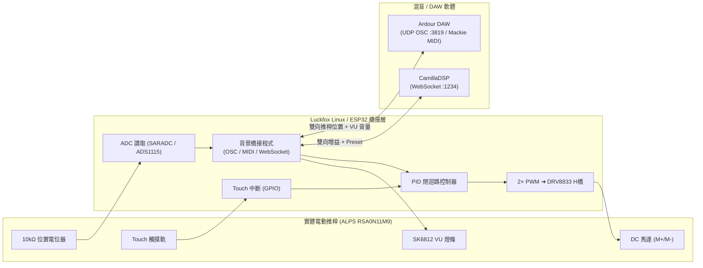

# 電動推桿 (Motorized Fader) 接開發板與 Ardour / CamillaDSP 雙向同步實作指南

本文件整理如何將 **電動推桿（以 `ALPS RSA0N11M9` 為例）** 接進 **Luckfox Linux 開發板（或 ESP32）**，並透過背景橋接程式轉換為 **OSC / Mackie Control / WebSocket** 協議，實現與 **Ardour DAW** 及 **CamillaDSP** 的完全雙向同步（硬體推桿控制軟體 ＋ 軟體移動帶動馬達歸位）。

---

## 一、關鍵觀念釐清：能直接用「普通 GPIO」讀寫電動推桿嗎？

**答案：不能只靠普通數位 GPIO（0/1），必須拆成「4 組不同訊號腳位」：**

| 推桿功能部位 | 能否直接接普通 GPIO？ | 正確接法與原因 |
| :--- | :---: | :--- |
| **1. 推桿滑動位置 (`10kΩ` 線性電位器)** | ❌ 不能只用數位 GPIO | 電位器輸出的是 `0V ~ 3.3V` **連續類比電壓**。必須接進 **ADC 腳位**（開發板內建 `SARADC` 或外掛 I2C `ADS1115` 16-bit 4路 ADC 模組），才能讀出 `0.0% ~ 100.0%` 的推桿位置。 |
| **2. 推桿直流馬達 (`M+ / M-`)** | ❌ 嚴禁 GPIO 直推 | 馬達啟動電流達數百 mA，直接接 GPIO 會燒毀主控。必須由 **2 支 PWM GPIO** 接進 **雙 H 橋馬達驅動 IC（如 `DRV8833` 或 `TB6612FNG`）** 來控制正反轉與速度。 |
| **3. 觸摸感應 (`Touch Sense` 電容軌)** | ⚠️ 可接數位 GPIO（搭感應模組） | 推桿帽連到內建的導電軌，接一顆低成本電容觸摸 IC（如 `TTP223` / `AT42QT1010`）轉成 `0/1` 高低電位進 GPIO；手一碰上就通知軟體 **暫停馬達 PID**，避免馬達跟人手打架。 |
| **4. 軌道 LED / VU 音量燈條** | ✅ 單線數位 GPIO (SPI / RMT) | 接 `SK6812 / WS2812` RGB 燈珠，顯示 Ardour / CamillaDSP 回傳的即時音量表（VU Meter）與 Mute / Solo 狀態。 |

---

## 二、整體雙向資料流架構（Hardware Bridge Daemon）

在 Luckfox Linux（或連上電腦的 MCU）上跑一支背景服務（`fader_bridge.py` / Rust Daemon），負責把「實體硬體電訊號」與「DAW 網路/MIDI 協議」雙向互轉：



---

## 三、三種軟體同步協議對照（Ardour vs. CamillaDSP）

| 目標軟體 | 推薦同步協議 | 預設連接埠 / 介面 | 推桿上傳指令範例（硬體 ➔ 軟體） | 軟體回傳同步（軟體 ➔ 馬達 / LED） |
| :--- | :--- | :--- | :--- | :--- |
| **Ardour DAW** *(方案 A：最推薦)* | **OSC** (Open Sound Control) | **UDP `3819`**<br>*(同一台本機走 `127.0.0.1`)* | `/strip/fader <軌道號> <0.0~1.0>`<br>`/strip/mute <軌道號> <0/1>` | Ardour 開啟 OSC 回傳（Feedback）後，主動推回 `/strip/fader`（驅動馬達）與 `/strip/meter`（驅動 VU LED） |
| **Ardour DAW** *(方案 B：跨 DAW 通用)* | **Mackie Control (MCU)** | **USB-MIDI / 虛擬 MIDI** | MIDI Pitch Bend (14-bit 高精度 16,384 階，比普通 7-bit CC 128 階更滑順) | DAW 主動發回相同 MIDI Pitch Bend（驅動馬達歸位）與 Channel Pressure（VU 錶） |
| **CamillaDSP** *(機內即時混音)* | **WebSocket JSON** (`pycamilladsp`) | **TCP `1234`**<br>*(本機或區網 IP)* | `SetVolume` / `SetMixer`（調整 dB 增益） | 切換 Preset 或 CamillaGUI 網頁拖動時，背景輪詢／訂閱最新 dB 值帶動馬達 |

---

## 四、馬達防搶手與 PID 閉迴路控制邏輯（核心演算法）

```text
每個控制週期 (建議 200Hz ~ 500Hz，每 2~5 ms 跑一次)：
1. 讀取 ADC 目前推桿位置 `pos_now` (0.0 ~ 1.0)，做滑動平均濾波消抖動。
2. 讀取 Touch 感應腳 `is_touched`：
   - 若 `is_touched == True`（人手握住推桿）：
     • 立即關閉 DRV8833 PWM（馬達放鬆進入滑行狀態）
     • 若 `|pos_now - last_sent| > 死區門檻`，立即發送 OSC / WebSocket 更新軟體音量！
   - 若 `is_touched == False`（人手放開）：
     • 比較 `error = target_from_software - pos_now`
     • 若 `|error| > 0.005`：經 PID 計算 PWM 佔空比與正反轉方向，驅動 DRV8833 把推桿滑向目標
     • 若 `|error| <= 0.005`：進入死區鎖定並煞車/關閉 PWM，防止馬達在目標點嗡嗡微震。
```

---

## 五、最小可驗證 BOM（4 路電動推桿原型測試）

| 序號 | 元件名稱 | 推薦型號 / 規格 | 數量 | 用途說明 |
| :---: | :--- | :--- | :---: | :--- |
| 1 | 電動推桿 | **`ALPS RSA0N11M9`** (100mm, B10K 線性, 含 Touch 軌) | 4 支 | 馬達供電約 `9V–10V`（一般接 9V DC 扭力與速度最順） |
| 2 | 馬達驅動板 | **`DRV8833` 雙 H 橋模組**（1 片可推 2 支馬達） | 2 片 | 接收開發板 `2× PWM` 訊號推動推桿正反轉 |
| 3 | 高精度 ADC | **`ADS1115` 16-bit 4路 I2C ADC 模組** | 1 片 | 若開發板內建 ADC 數量不夠或雜訊大，用 1 片即可讀 4 支推桿 |
| 4 | 觸摸感應 | **`TTP223`** 或 **`AT42QT1010`** 電容觸摸模組 | 4 顆 | 接推桿 Touch 腳，轉成乾淨 `0/1` GPIO 防搶手訊號 |
| 5 | 馬達獨立電源 | **`9V / 2A` 獨立電源**（與類比音訊地分離，電源入口共地） | 1 組 | 避免馬達啟動電流干擾 ADC 讀值與麥克風前級 |

---

## 六、橋接程式語言選擇、系統自動化與硬體工程細節

1. **橋接程式開發語言選擇**：
   * **Python（最快驗證原型）**：在 Luckfox Linux 直接用 `python3` 開發，搭配現成套件 `python-osc`（發收 Ardour OSC）、`mido` / `python-rtmidi`（Mackie Control MIDI）、`pycamilladsp`（CamillaDSP WebSocket）與 `smbus2`（讀 `ADS1115`），數十行即可打通。
   * **C / C++ 或 Rust（正式量產首選）**：CPU 佔用極低、可穩定維持 `200Hz–500Hz` 馬達 PID 閉迴路且不搶佔音訊 DSP 執行緒。
2. **開機自動化（`systemd`）**：
   * 將橋接程式註冊為 Linux 系統服務（`/etc/systemd/system/fader-bridge.service`），執行 `sudo systemctl enable --now fader-bridge`，開機後自動啟動並於異常退出時自動重啟（`Restart=always`）。
3. **外殼屏蔽、散熱與訊號隔離**：
   * 金屬機箱接地屏蔽干擾；Core3576（8 核）高負載跑多軌 DSP 需貼散熱片／導熱墊至機殼散熱；類比前級與馬達 `9V` 電源／高速 TDM 走線分區隔離，僅在電源入口做星狀單點接地。

---

## 七、Luckfox 開發流程與作業系統燒錄步驟

1. **怎麼灌系統（燒錄官方 Linux 鏡像）**：
   * **MicroSD 卡開機（最簡單）**：下載 Luckfox 官方系統鏡像（Buildroot / Debian / Ubuntu），用電腦讀卡機搭配 **`balenaEtcher`**、**`Rufus`** 或瑞芯微 **`SDDiskTool`** 寫入記憶卡，插卡即開機。
   * **板載 eMMC / SPI NAND Flash 燒錄（正式量產用，如 Core3576 / Core3566）**：在 Windows 安裝瑞芯微 **`RKDevTool`** 與 USB 驅動（`DriverAssitant`），**按住板載 `BOOT`（或 `MASKROM`）按鍵不放再插上 Type-C 連接電腦**，於 `RKDevTool` 匯入官方 `.img` / 分區檔按下「執行（Run）」即可寫入板載記憶體。
2. **怎麼把程式寫進 Luckfox 裡面**：
   * **方式 A（本機直接開發 — Python 最方便）**：接上網線或 USB RNDIS 虛擬網卡，用 **`SSH`**（或 `ADB`）連進 Luckfox 終端機，直接編輯並執行 `python3 fader_bridge.py`。
   * **方式 B（電腦交叉編譯 — C / C++ / Rust）**：在電腦安裝對應的 ARM / ARM64 Cross-Toolchain 編譯出執行檔後，透過 `scp` 傳進 Luckfox，再掛入 `systemd` 背景常駐執行。

---

## 八、Linux ARM64 即時混音軟體與原生 LV2 / CLAP 插件下載管道

1. **系統與架構選擇**：
   * **Luckfox Core3576 / Core3566**：裝官方 **Debian 12 (`arm64` / `aarch64`)** 或 **Buildroot**（勿裝 PC 版 Ubuntu）。
   * **Luckfox Lyra (`RK3506G2`)**：裝官方 **Debian 12 (`armhf`)** 或 **Buildroot**。
2. **原生 ARM64 即時混音／DAW 軟體**：
   * **`Ardour`**（全功能調音台 + OSC/Mackie）、**`Non-Mixer-XT`**（極簡通道條混音座）、**`Qtractor`**、**`CamillaDSP + CamillaGUI`**（無頭超低延遲 DSP）、**`Carla`**（插件宿主機架）、**`PipeWire` / `JACK (jackd2)`**。
3. **LV2 / CLAP 插件數量與下載來源（ARM64 原生免轉譯）**：
   * **Debian 官方套件庫（最穩、一鍵 `apt install`）**：
     ```bash
     sudo apt update
     sudo apt install lsp-plugins-lv2 dragonfly-reverb-lv2 x42-plugins calf-plugins
     ```
     *（涵蓋專業參數 EQ、壓縮器、Gate、Limiter、殘響、即時頻譜與音量錶；`lsp-plugins` 與 `dragonfly-reverb` 亦提供 `-clap` 與 `-vst3` 原生 ARM64 包。）*
   * **KXStudio 官方 ARM64 軟體源**：https://kx.studio/Repositories （提供大量專門打包好的 Linux ARM64 音訊插件與宿主）。
   * **開源社群與插件目錄**：[LinuxAudio Plugins Wiki](https://wiki.linuxaudio.org/apps/all/start)、GitHub 上開源專案（如 `Airwindows`、`Surge XT`、`ZL Equalizer`）皆可抓原始碼或 ARM64 `.deb/.tar.gz` 使用。
   * ⚠️ **注意**：PC 商業 Windows VST（Waves / FabFilter 等 `.dll`/`.vst3`）為 `x86_64` 架構，在 ARM 上跑 Wine/Yabridge 延遲與穩定度不適合現場控台，實務請全面採用原生 **LV2 / CLAP**。
