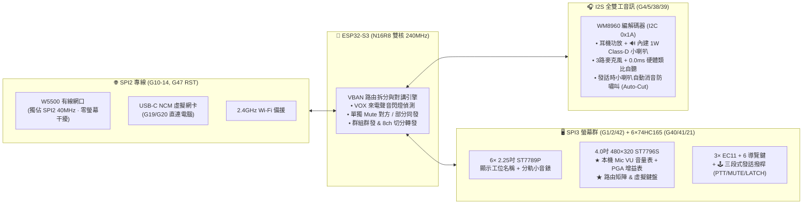

# ESP32-S3 獨立 VBAN 路由拆分與 36 鍵多工位 Intercom 主站設計規範書（v2 專業廣電對講版）

本文件定義與「80 鍵導播切換台」搭配使用的獨立姊妹機：**ESP32-S3 VBAN 音訊路由拆分器 & 36 鍵（`6× [2×3]`）多工位 IP 對講主站（Standalone VBAN Matrix Router & Intercom Master Station）**。

> 搭配互動式視覺化網頁與工程圖紙使用：
> * 🖨️ **【推薦列印】A4 橫式好列印版 5 頁工程接線圖冊（含黑白省墨模式與雙機 BOM）**：[esp32s3_v2_and_intercom_printable.html](./esp32s3_v2_and_intercom_printable.html)
> * 🌐 **【互動體驗】36 鍵面板燈號模擬器 & ESP32-S3 內建 Web UI 設定後台原型（含固定 IP / VBAN 改名上屏）**：[vban_system_overview_and_webui.html](./vban_system_overview_and_webui.html)
> * 🗺️ **VBAN Intercom 主站全部接線總電路圖（單頁大圖 HTML）**：[vban_intercom_wiring_big.html](./vban_intercom_wiring_big.html)
> * 主導播台（80 鍵）設計規範書：[../README.md](../README.md)

---

## 一、核心定位與黃金雙 SPI 硬體優勢

這台獨立單體專職處理 **「多工位 IP 語音對講（Intercom）」** 與 **「區網 VBAN 多聲道接收、切分（Channel Split）、混音與重打包轉發（Relay）」**。因為按鍵數精簡為 **36 鍵 + 6 顆導覽鍵 + 3 顆旋鈕 + 1 支三段式發話撥桿**，主控 `ESP32-S3-DevKitC-1 (N16R8)` 得以實現**音訊級零阻塞硬體架構**：

1. **網口與螢幕徹底分流（雙獨立硬體 SPI）**：
   * **`SPI2 (FSPI)` 100% 獨佔給 `W5500` 有線網口**：以 `40MHz` DMA 全速收發 VBAN UDP 音訊封包，**總線上沒有任何一顆螢幕搶頻寬**，封包轉發延遲 `< 2 ms`、零爆音！
   * **`SPI3 (HSPI)` 專供 `6× 2.25" ST7789P` + `1× 4.0" ST7796S Config 大屏`**：即使 4.0" 大屏全畫面刷新或高速跳動 Mic VU 音量表，也完全不影響 `SPI2` 的 VBAN 音訊流。
2. **零延遲硬體即時自聽（0.0 ms Hardware Sidetone）**：
   * 透過 **`WM8960` 內建類比旁路混音器（Input Boost Mixer → Headphone Output）**，本機麥克風聲音在晶片內部直接以類比路徑混入耳機，**延遲為 `0.0 ms`**（不會有數位迴路 5–10 ms 的梳狀濾波空谷感），且可透過 I2C 暫存器以 `3dB` 步進精準調整自聽音量，當撥桿切至 `MUTE` 時同步硬體切斷自聽。
3. **三段式發話撥桿開關（`(ON)-OFF-ON`：下壓 PTT / 中置 MUTE / 上扳持續發話 Latch）**：
   * 導入廣電標準（RTS / Clear-Com 風格）**單刀雙擲 3 段式搖頭撥桿開關**，直接接在 `U6.F (LATCH)` 與 `U6.G (PTT)`：往下壓為彈回式瞬時發話（PTT）、放手回到中間為全機麥克風靜音（MUTE）、往上扳則鎖定為免持持續發話（Latch）。



---

## 二、面板配置：6 組 `[2×3]` 呼叫工位 Pod + 4.0" 大屏（含 Mic 音量/增益表）+ 發話撥桿

上方左側為 **4.0" Config 大螢幕（常駐本機 Mic 即時 VU 音量表、PGA 增益表與 Sidetone 自聽表）**；上方右側為 **3 顆旋鈕 + 6 顆導覽鍵 + 1 支三段式發話撥桿（`LATCH / MUTE / PTT`）**；下方由 **6 組 `2高×3寬` 按鍵模組（`Pod 1–6`，共 36 鍵）** 組成：

```text
┌────────────────────────────────────────────────────────┬────────────────────────────────────────┐
│ [ 4.0" 480×320 ST7796S · 監控儀表 & VBAN Config 大屏 ]  │  🔘 E1 耳機/喇叭音量 🔘 E2 PGM/自聽混音│
│  ┌──────────────────────────────────────────────────┐  │  (短按S2切換喇叭開關)  (PCNT1 · G15/16)  │
│  │ 🎙️ MIC VU : [███████████▓▓░░] -6dB  [CLIP: OK]   │  ├───────────────────┬────────────────────┤
│  │ 🎚️ MIC GAIN: [+24 dB ───●────]  🎧自聽: [-6 dB]   │  │ 🔊 內建 1W 小喇叭 │ 🕹️【三段發話撥桿】 │
│  │ 📥 RX Bus8ch -> Split1:CAM1  Split2:AUD  [VOX:ON]│  │ (WM8960 SPK_L/R)  │ ▲ 上扳: 持續發話   │
│  │ 🎯 同發已選: [CAM1] + [CAM4] + [AUD] (共 3 工位) │  │ 🔘ENC3 [▲][▼][◀][▶]│ ● 中置: MUTE 靜音  │
│  └──────────────────────────────────────────────────┘  │  [⏎進入]  [⎋離開] │ ▼ 下壓: 彈回式 PTT │
├───────────────────────────┬────────────────────────────┼───────────────────┴────────────────────┤
│ [ 2.25" LCD #1 · GPA0 ]   │ [ 2.25" LCD #2 · GPA1 ]    │ [ 2.25" LCD #3 · GPA2 ]                │
│ Pod 1 導播與核心組 (K0–5)  │ Pod 2 攝影機工位群 (K6–11) │ Pod 3 特種機位與視訊 (K12–17)           │
│  DIR導播   AD副導   PROD製作│  CAM1一機  CAM2二機  CAM3三機│  CAM7七機  CAM8八機  JIB搖臂           │
│  AUD音控   CG字幕   VTR慢動作│  CAM4四機  CAM5五機  CAM6六機│  STEAD穩定 DRONE航拍  POV微距          │
├───────────────────────────┼────────────────────────────┼────────────────────────────────────────┤
│ [ 2.25" LCD #4 · GPA3 ]   │ [ 2.25" LCD #5 · GPA4 ]    │ [ 2.25" LCD #6 · GPA5 ]                │
│ Pod 4 舞台與燈光組 (K18–23)│ Pod 5 群組群發與耳返(K24–29)│ Pod 6 部分同發 / 單獨Mute / 路由(30–35)│
│  STG舞台   LGT燈光  LED大屏 │  ALL全體發 GRP1攝影群 GRP2技術│  MULTI同發  MUTE_IN禁聽  CLR清空選取   │
│  HOST主持  GUEST來賓 FLOOR場│  GRP3舞台群 IFB1主持  IFB2來賓│  SPL1拆分1  SPL2拆分2    DUCK自動閃避  │
└───────────────────────────┴────────────────────────────┴────────────────────────────────────────┘
```

---

## 三、廣電級 Intercom 對講操作邏輯（閃燈、Mute 對方、群發、部分同發、撥桿）

### 3.1 來電有聲音自動閃燈（VOX Audio Tally + Call Flash）
每顆工位鍵下的 **`SK6812` RGB 燈珠** 與正上方 **`2.25"` 彩屏對應格** 會根據即時音訊狀態變色與閃爍：
* 🟠 **橘白快閃（VOX 語音能量觸發）**：韌體即時計算每條工位 VBAN 輸入音軌的 RMS 電平，**只要對方開口講話（超過門檻如 `-40 dBFS`）**，即使對方沒按 Call 呼叫鍵，該工位按鍵也會**立刻隨語音節奏閃爍**，同時 `2.25"` 螢幕上該工位方格會跳動綠色小音柱，讓你秒抓是誰在講話！
* 🔴 **紅燈急促爆閃（Incoming Call 呼叫信令）**：對方主動按呼叫鍵找你時紅白交替閃爍（可選配觸發 `MCP GPB2` 蜂鳴器提示音）。
* 🟢 **綠燈常亮（Talk 發話中）**：你的麥克風正在對該工位發送語音。
* 🩵 **青色呼吸燈（Multi-Select 預選同發）**：已勾選加入「部分同發」名單，等待你壓下發話撥桿。
* 🟣 **紫紅暗燈 + 螢幕顯示 `🔇MUTE`（單獨 Mute 對方）**：你已將該工位的來話靜音（不聽他的聲音）。

### 3.2 怎麼單獨 Mute 掉某個吵雜的工位？（Listen Mute 禁聽功能）
當現場某個工位（例如 `CAM 3`）忘了關麥克風一直傳來環境噪音時，有兩種方式立刻 Mute 他：
1. **直覺雙擊**：在任意工位鍵上**快速連按兩下（Double-Click）**，立即切換該工位的 **「禁聽（Listen Mute）」** 狀態（按鍵變紫紅燈，`2.25"` 螢幕該格打上紅色 `🔇MUTE` 標籤，將他在本機混音矩陣的權重設為 `0`）。
2. **組合鍵模式**：按住 `Pod 6` 的 **`K31 [MUTE_IN 禁聽模式]`** 不放，再點選任意幾顆工位鍵，即可批次 Mute / 解開多個工位的聲音（另外也支援發送 VBAN-TEXT 指令遠端把對方的麥克風切掉）。

### 3.3 群組群發（Group Call）vs 可選「部分同發（Multi-Select Partyline）」
1. **一鍵群組群發（`Pod 5` 固定群組：`K24–K27`）**：
   * `K24 [ALL 全體廣播]`、`K25 [GRP1 全攝影機群]`、`K26 [GRP2 音控/字幕/VTR 技術群]`、`K27 [GRP3 舞台/燈光/場控群]`。
   * 直接按住即對整個群組廣播（PTT），或點選後配合發話撥桿對全群組持續發話。
2. **自由勾選「部分同發（Multi-Select Talk）」**：
   * 例如你想同時跟 **`CAM 1` + `CAM 5` + `AUD 音控`** 三個人講話（不想吵到其他人）：
   * **步驟 1**：直接短按點選 `CAM 1`、`CAM 5`、`AUD` 三顆按鍵（被選中的按鍵亮起**青色預選燈**，4.0" 大螢幕顯示 `🎯 同發目標：CAM1, CAM5, AUD`）。
   * **步驟 2**：直接操作右上角的 **「🕹️ 三段式發話撥桿」**（或踩背板腳踏 PTT），本機麥克風聲音就會**同時打包發給這 3 個工位**！
   * **步驟 3**：講完想重選名單時，按一下 `Pod 6` 的 **`K32 [CLR 清空選取]`** 即可一鍵清除所有勾選。

### 3.4 三段式發話撥桿開關（`LATCH / MUTE / PTT`）與按鍵直發
為滿足導播高強度盲操作，面板提供**雙軌發話控制**：
* **方式 A：使用「🕹️ 三段式搖頭撥桿開關 `(ON)-OFF-ON`」（推薦主力操作）**
  * 選用工業級 **單刀雙擲 3 段式搖頭開關（一邊自鎖 `ON`、中間 `OFF`、另一邊自動彈回 `(ON)`）**，中間公共腳接 `GND`，兩側輸出分別接 `U6.F` 與 `U6.G`：
    * **▼ 往下壓住（Momentary PTT，`U6.G = 0`）**：對目前所有已勾選的工位立即發話，手一放開自動彈回中間靜音！
    * **● 中間位置（Center OFF = MUTE，`U6.F=1, U6.G=1`）**：本機麥克風強制靜音（同時切斷自聽與外部 On-Air 紅燈）。
    * **▲ 往上扳緊（Latch 持續發話，`U6.F = 0`）**：鎖定持續發話，雙手可以離開去推導播台 T-Bar！
* **方式 B：直接按工位鍵發話（無需動撥桿）**
  * 即使撥桿放在中間，只要直接**長按（Hold > 250ms）** 任何一顆工位鍵或群組鍵，也會立即對該單一工位/群組啟動 **直通 PTT 發話**，放開即停。

---

## 四、4.0" 大螢幕儀表板：本機 Mic 音量表、增益表與即時自聽（Sidetone）

### 4.1 螢幕常駐雙音錶設計（Mic VU Meter + Gain / Sidetone Bar）
在 `4.0" (480×320 ST7796S)` 螢幕頂部固定切出 `80px` 高的**高幀率專業音訊儀表帶（局部刷新 `30 fps`）**：
1. **本機麥克風即時音量表（Mic Input VU & Peak Meter）**：
   * 顯示範圍 `-60 dBFS` ～ `0 dBFS`，分三段顏色：**綠色（`-60 ~ -18 dB` 安全區）**、**黃色（`-18 ~ -6 dB` 最佳語音動態區）**、**紅色（`-6 ~ 0 dB` 警戒區）**。
   * 具備 **Peak Hold（峰值游標停留 1.5 秒）** 與 **`CLIP` 破音警告紅燈**，一眼確認自己講話有沒有爆音或太小聲。
2. **麥克風前級增益表（Mic PGA Gain Meter）與 Noise Gate 門檻**：
   * 視覺化長條圖顯示目前 `WM8960` 的硬體前級放大倍率（**`0 dB` ～ `+30 dB` 類比 PGA + 數位微調**），以及 **Noise Gate（噪音門檻線）**，低於門檻時自動衰減環境底噪。
3. **耳機即時自聽音量表（Zero-Latency Sidetone Meter）**：
   * 顯示本機麥克風直接混入自己耳機的自聽比例（`-21 dB` ～ `+6 dB` 或 `OFF`）。

### 4.2 如何做到「0.0 ms 零延遲即時聽到自己的聲音」？
* 傳統數位做法（`ADC -> I2S 進 ESP32 -> 混音 -> I2S 出 DAC`）會有約 `6~12 ms` 的緩衝延遲，戴封閉式耳機講話時會與頭骨傳導聲音疊加產生難受的回音感。
* **本機採用 `WM8960` 硬體類比 Sidetone 通路**：
  * 將 `WM8960` 暫存器 `R47 (Left Output Mixer)` 與 `R48 (Right Output Mixer)` 中的 **`LI2LO / RI2RO`（Input Boost Mixer to Output）** 打開。
  * 麥克風訊號經過晶片內部的低雜訊前級（PGA）後，**一路由 ADC 轉成數位 I2S (`G39`) 送給 ESP32 打出 VBAN 與畫音量表；另一路直接在晶片內部類比混入耳機放大器 (`HP_L/HP_R`)**！
  * **效果**：完全不經過軟體 Buffer，**真正 `0.0 ms` 零延遲即時自聽**，而且按 `E2` 旋鈕就能即時調整自聽大小聲！

### 4.3 🔊 面板內建監聽小喇叭（Class-D 1W）與「發話防嘯叫自動消音（Speaker Cut / Dim）」
`WM8960` 晶片除了耳機功放外，**原生內建一組獨立的 `1W @ 8Ω Class-D 立體聲喇叭功放（SPK_LP/LN, SPK_RP/RN）`**，不需外加功放晶片、也不佔任何 GPIO：
* **免戴耳麥值班模式**：平時不戴耳機時，可直接由面板右上角的 **`8Ω / 1W～2W` 腔體小喇叭** 播放各工位呼叫與 PGM 背景音（按一下 `E1` 旋鈕 `S2` 即可快速切換「小喇叭 ON / OFF」）。
* **智慧防嘯叫連鎖（Auto Speaker Cut / Dim Interlock）**：
  * **自己只送耳機、絕不進小喇叭**：`WM8960` 的 `0.0ms` 類比自聽（Sidetone）只路由到耳機 `HP_L/HP_R`，**硬體禁止路由到 `SPK_LP/LN`**。
  * **發話時自動切斷/壓低小喇叭**：一旦你扳動三段式發話撥桿（`PTT` 或 `Latch`）打開本機麥克風對外講話，韌體立即透過 I2C 將 `WM8960` 的 `SPKVOL` 喇叭音量暫存器瞬間靜音（或衰減 `-20 dB` Dim），放開撥桿後自動恢復 —— **徹底杜絕面板內建麥克風/鵝頸麥與小喇叭之間的回授嘯叫（Acoustic Feedback）**！
### 4.4 🎙️ 四合一專業音訊輸入前端：XLR (`OFF / +5V / +48V`) + 6.35mm (`Mic / Line-In`) + 3.5mm 耳麥 + 機載 MEMS
為適應導播室與現場各種工位設備，本機音訊前端與 80 鍵主導播台採用 **100% 相同的四合一架構**（由 `MCP23017 GPB3–GPB5` 與 `WM8960` I2C 暫存器共同控制，**零額外主控 GPIO**）：

| 輸入編號 | 實體接口 | 供電 / 增益模式（可在 4.0" Config 大螢幕切換） | 硬體設計與保護說明 |
| :--- | :--- | :--- | :--- |
| **`MIC 1`** | **3.5mm 耳麥麥克風孔** | 內建 `MICBIAS (~2.5V)` 偏壓 | 直連 `WM8960 LINPUT1`，供一般耳麥 / 領夾麥使用 |
| **`MIC 2`** | **XLR 3-Pin 平衡母座**（可選 **Combo 複合座**） | 支援 **3 種模式**：`OFF (動圈麥)` / **`+5V 模式` (低壓電容鵝頸麥)** / **`+48V 幻象電源` (專業電容麥)** | `MCP GPB3` 控 `5V→48V` 升壓（經配對 `6.81kΩ` 送 Pin 2/3）；`GPB4` 控 `+5V` 偏壓；經 **`22μF/63V` 隔直電容 + 鉗位二極體 + `INA217` 平衡前級** 進 `LINPUT2` |
| **`IN 3`** | **6.35mm (1/4") TRS 母座**（Combo 座中心孔） | 支援 **2 種模式**：**`MIC 模式` (+20~+30dB 高增益)** / **`LINE-IN 模式` (投入 `-20dB Pad` 衰減 + 0dB 線路電平)** | 中心 6.35mm 孔**不帶 48V 電**，安全接 6.35mm 動圈麥或外部混音器/電腦 Line-In（由 `MCP GPB5` 切換 `-20dB Pad` 衰減器並進 `LINPUT2 / RINPUT2`） |
### 4.5 🏷️ VBAN 裝置名稱自動傳輸上屏 & 🌐 內建 Web UI 網頁管理後台（`HTTP 80` + `NVS` 永久儲存）

#### 1. VBAN 裝置之間如何自動傳輸名稱並顯示在 `2.25"` / `4.0"` 螢幕上？
本系統同時支援 **雙層名稱同步機制**，只要遠端工位改名，全場所有機器的螢幕自動跟著改名：
* **第 1 層（100% 相容電腦 Voicemeeter）**：每個 VBAN 封包的 28-byte 標頭內建 **16 Bytes `streamname` 欄位**（Byte `8–23`，如 `"CAM1_SONY"`、`"DIR_DESK"`）。接收端收到音訊封包瞬間即可提取該名稱，直接畫在對應的 **`2.25"` 小彩屏方格** 與 **`4.0"` 大螢幕路由表**上！
* **第 2 層（ESP32 工位互聯擴充 · 支援完整中文長名稱）**：各台 ESP32-S3 每 2 秒透過 **`VBAN-SERVICE / VBAN-TEXT` 子協議**（UDP `6980`）與 **mDNS (`_vban._udp.local`)** 自動廣播本機 JSON 身分卡：
  ```json
  {"id":"intercom-cam1", "name":"一號機-搖臂(阿明)", "stream":"CAM1_TALK", "ip":"192.168.1.101", "mute":false}
  ```
  因此 `2.25"` 彩屏上可優先顯示對方設定的**完整中文名稱（如 `一號機-搖臂`）**，若對方是一般電腦 Voicemeeter 則自動退回顯示 16 字元 `streamname`！

#### 2. 內建 Web UI 網頁設定後台（與本機 4.0" Config 大螢幕 100% 雙向同步 + `NVS` 斷電儲存）
不需安裝任何電腦軟體，直接用瀏覽器連入本機 IP（或 `http://intercom-main.local` / USB-C `http://192.168.7.2`），即可操作內建於 `16MB Flash (LittleFS)` 的現代化設定網頁。**所有在 4.0" Config 大螢幕能設定的項目，網頁上 100% 都能設定，且按下儲存後立刻寫入 `NVS (Non-Volatile Storage)` 永久保存並即時刷新螢幕**：
* **🏷️ 裝置名稱與 VBAN 身分**：設定本機中文工位名稱、VBAN 16 字元 `streamname`、mDNS 主機名（儲存後立即推播給全區網其他 Intercom 與導播台更新螢幕標籤）。
* **🌐 網路與固定 IP 設定（Static IP / DHCP）**：
  * **W5500 有線網口**：可自由切換 `DHCP` 或 **`固定 IP (Static IP / 子網路遮罩 Subnet / 預設閘道 Gateway / DNS)`**。
  * **Wi-Fi 無線網路**：設定 `SSID`、密碼、切換 `DHCP` 或 **`固定 IP`**。
  * **USB-C 虛擬網卡**：設定 USB NCM 固定區網 IP。
* **🎛️ 36 鍵 (`Pod 1–6`) 工位映射與 8ch VBAN 拆分路由表**：
  * 在網頁表格直覺配置 `KEY 0–35` 每顆按鍵對應的目標工位 IP / Stream，並可勾選「**自動使用對方 VBAN 傳來的裝置名稱作為螢幕標籤**」或「手動覆寫標籤」。
  * 設定 8 聲道總線的 **切分轉發規則 (`Split Route 1–6`)**、群組群發名單 (`GRP 1–3`)、VOX 來電閃燈門檻 (`-60 ~ -20 dBFS`) 與 Auto-Ducking 衰減量。
* **🎙️ 四合一音訊前端與硬體參數**：網頁即時切換 `3.5mm` / `XLR (OFF / +5V / +48V)` / `6.35mm (Mic / Line-In)` / `機載 MEMS`、調整 Mic PGA 增益、0ms 自聽音量、內建小喇叭開關，並支援 **`.json` 設定檔一鍵匯出/匯入備份** 與 **Web OTA 韌體更新**。

---

## 五、ESP32-S3-DevKitC-1 (N16R8) 全腳位分配表（雙 SPI 分流版）

| 類別 | ESP32-S3 GPIO | 連接目標 | 說明 |
| :--- | :--- | :--- | :--- |
| **SPI2（網口專線）** | `G10 (CS)`, `G11 (MOSI)`, `G12 (SCLK)`, `G13 (MISO)`, `G14 (INT)`, `G47 (RST)` | **`W5500` 有線網口** | **100% 獨佔 `SPI2`**，不與任何螢幕共用！`G47` 直連 W5500 `RST` |
| **SPI3（螢幕專線）** | `G1 (MOSI/SDA)`, `G2 (SCLK/SCL)`, `G42 (DC 共用)` | **6× `2.25"` + 1× `4.0"` 彩屏** | **獨立 `SPI3` 總線**（分支串 `33Ω`），30fps 刷音量表絕不卡音訊 |
| **I2C 總線** | `G8 (SDA)`, `G9 (SCL)` | `MCP23017 (0x20)` + `WM8960 (0x1A)` | 4.7kΩ 上拉至 3.3V |
| **I2S0 全雙工音訊** | `G4 (BCLK)`, `G5 (LRCK)`, `G38 (DOUT)`, `G39 (DIN)` | **`WM8960` 編解碼模組** | 48kHz 全雙工：耳機輸出 + 三種麥克風輸入（畫 VU 表與發 VBAN） |
| **3× EC11 旋鈕** | `G6/G7` (`E1`), `G15/G16` (`E2`), `G17/G18` (`ENC3`) | **硬體 `PCNT0 / 1 / 2`** | `E1` 耳機音量、`E2` PGM/自聽混音、`ENC3` 選單/Mic 增益微調 |
| **74HC165 掃描鏈** | `G40 (CLK)`, `G41 (SH/LD)`, `G21 (QH 讀入)` | **`U1–U6` 共 6 片 `74HC165`** | `2 kHz` 掃描 48 bits（36 鍵 + 6 導覽鍵 + 3 旋鈕 S2 + 三段發話撥桿 + 腳踏 PTT） |
| **SK6812 燈鏈** | `G48`（串 `330Ω`） | **36 顆 `SK6812 MINI-E`** | `LED #0–#35`（支援 VOX 來電閃爍、Mute 紫燈、同發青燈、發話綠燈） |
| **USB / UART0** | `G19/G20` (USB-C), `G43/G44` (UART0) | 板載雙 Type-C 孔 | USB NCM 虛擬網卡 + 燒錄除錯口 |
| **禁區保留** | `G0, G3, G35, G36, G37, G45, G46` | 嚴禁外接 | Octal PSRAM 與 Strapping 腳位 |

---

## 六、擴充晶片一對一映射表（6× `74HC165` 100% 滿載 + 1× `MCP23017`）

### 6.1 `74HC165` 菊花鏈（共 6 片 = 48 路輸入，48/48 全數精準分配！）
| 晶片編號 | 輸入腳 `A–H` 分配 | 對應功能 |
| :--- | :--- | :--- |
| **`U1`** | `A–F` = `Pod 1 (K0–5)`；`G–H` = `Pod 2 前 2 鍵 (K6–7)` | 核心組 + 攝影機 1–2 |
| **`U2`** | `A–D` = `Pod 2 後 4 鍵 (K8–11)`；`E–H` = `Pod 3 前 4 鍵 (K12–15)` | 攝影機 3–8 + 搖臂/穩定器 |
| **`U3`** | `A–B` = `Pod 3 後 2 鍵 (K16–17)`；`C–H` = `Pod 4 整組 (K18–23)` | 航拍/POV + 舞台/燈光/主持 |
| **`U4`** | `A–F` = `Pod 5 群組群發與耳返 (K24–29)`；`G–H` = `Pod 6 (K30 同發 / K31 禁聽)` | `ALL / GRP1–3 / IFB1–2` + 同發/禁聽模式鍵 |
| **`U5`** | `A–D` = `Pod 6 後 4 鍵 (K32 清空 / K33–34 拆分 / K35 閃避)`；`E–G` = `E1/E2/ENC3` 按壓 `S2`；`H` = **`▲ 上`** | 功能鍵 + 3 顆旋鈕按壓 + 導覽上鍵 |
| **`U6`** | `A`=`▼下`, `B`=`◀左`, `C`=`▶右`, `D`=`⏎進入`, `E`=`⎋離開`；**`F`=`撥桿上扳 LATCH`**；**`G`=`撥桿下壓 PTT`**；**`H`=`背板腳踏 PTT`** | 導覽鍵 + **三段式發話撥桿（兩側都沒觸發即為中間 `MUTE`）** + 腳踏開關 |

> 💡 **三段式撥桿開關 (`(ON)-OFF-ON`) 接線秘訣**：
> * 撥桿共有 3 支腳：中間公共腳 (`COM`) 接 `GND`；上側自鎖腳接 **`U6.F`**；下側彈回腳接 **`U6.G`**。
> * 韌體判斷：`U6.F == 0` 為 **持續發話 (Latch)**；`U6.G == 0` 為 **按住發話 (PTT)**；當 `U6.F == 1 && U6.G == 1`（撥桿處於中間）時即為 **強制靜音 (MUTE)**！

### 6.2 單顆 `MCP23017 (0x20)` 腳位分配（16 路用 14 路，預留 2 路）
| 腳位 | 連接目標 | 腳位 | 連接目標 |
| :--- | :--- | :--- | :--- |
| `GPA0` | **`LCD #1` CS1** (`Pod 1`) | `GPB0` | **`4.0" ST7796S` 大屏 `BL` 背光開關**（經 NMOS） |
| `GPA1` | **`LCD #2` CS2** (`Pod 2`) | `GPB1` | 機箱頂部 **On-Air 發話紅燈輸出**（發話時自動點亮） |
| `GPA2` | **`LCD #3` CS3** (`Pod 3`) | `GPB2` | 呼叫蜂鳴器 **Call Buzzer** 輸出 |
| `GPA3` | **`LCD #4` CS4** (`Pod 4`) | **`GPB3`** | **XLR `+48V` 幻象電源啟閉控制**（`5V→48V` 升壓模組） |
| `GPA4` | **`LCD #5` CS5** (`Pod 5`) | **`GPB4`** | **XLR `+5V` 偏壓供電模式控制**（切換 `OFF / +5V / +48V`） |
| `GPA5` | **`LCD #6` CS6** (`Pod 6`) | **`GPB5`** | **6.35mm TRS `MIC / LINE-IN (-20dB Pad)` 模式切換** |
| `GPA6` | **`4.0" ST7796S` 大屏 `CS_BIG`** | `GPB6–GPB7` | **2 路預留 GPIO** |
| `GPA7` | **全部 7 塊螢幕共用 `RES` 復位** | | |

---

## 七、專屬採購清單（BOM）

| 序號 | 物料名稱 | 規格型號 | 數量 | 備註 |
| :--- | :--- | :--- | :---: | :--- |
| 1 | 主控開發板 | `ESP32-S3-DevKitC-1 (N16R8)` | 1 | 與主導播台相同 |
| 2 | 有線網口模組 | `W5500` SPI 模組（可搭配 **5V PoE 分離器**） | 1 | 獨佔 `SPI2`，加 PoE 分離器即可單網線供電 |
| 3 | 工位長條彩屏 | 中景園 `2.25" 76×284 ST7789P` (`ZJY225S0800TG01`) | **6** | 對應 `Pod 1–6`（顯示工位名、Mute 狀態與 VOX 音柱） |
| 4 | Config 大螢幕 | **`4.0" 480×320 ST7796S` SPI 彩屏（不含觸控）** | **1** | 常駐 **Mic VU 音量表 + PGA 增益表 + 自聽表** + 虛擬鍵盤 |
| 5 | **三段式發話撥桿** | **單刀雙擲 3 段式搖頭開關 `(ON)-OFF-ON`（一邊彈回、中間停、一邊自鎖）** | **1** | 建議選扁柄金屬撥桿（如 `MTS-123` 單邊復位型），手感最接近 RTS 面板 |
| 6 | **音訊編解碼與四合一前端** | **`WM8960` 模組** + **`Neutrik NCJ6FI-S` (XLR+6.35mm Combo 座)** + **`5V→48V` 幻象升壓** + `INA217` 平衡前級 + 3.5mm 座 + **機載類比 MEMS 麥克風** | 1 套 | 齊備 **3.5mm 耳麥 + XLR (OFF/5V/48V) + 6.35mm (Mic/Line-In) + 機載 MEMS** |
| 6b | **面板監聽小喇叭** | **`8Ω / 1W～2W` 帶音腔全頻小喇叭（如 `4020` / `3020` 腔體喇叭，附 JST 2P 線）** | **1–2** | 直連 `WM8960` 的 `SPK_LP/LN`（發話時韌體自動 Cut 防嘯叫） |
| 7 | 機械軸與 RGB 燈 | 凱華靜音軸 + `SK6812 MINI-E` 反貼燈珠 + 1U 鍵帽 | **36** | 6 組 `2×3` 呼叫工位鍵（支援 VOX 來電閃燈） |
| 8 | 旋鈕與導覽鍵 | **3 顆 `EC11` 旋鈕** + **6 顆導覽鍵（`▲▼◀▶ ⏎ ⎋`）** | 3 + 6 | `E1` 耳機、`E2` PGM/自聽、`ENC3` Config/Mic 增益 |
| 9 | 移位暫存器 | `SN74HC165D` + `10kΩ` 9 腳排阻 `A103J` | **6** | `U1–U6`（48/48 路滿載） |
| 10 | I2C IO 擴充 | `MCP23017-E/SP` (`0x20`) | **1** | 管 7 塊螢幕 + On-Air 燈 + 蜂鳴器 |
| 11 | 電源模組 | `5V / 3A` 電源（或 PoE 分離器）+ `5V→3.3V/2A` 降壓 | 1 套 | 36 顆燈峰值 `1.6A` |
